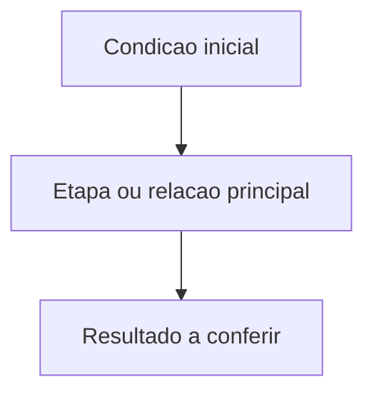

# [Título que descreve a decisão prática]

::: tip Resumo Pareto
[Decisão principal e limite de aplicação em até três frases.]
:::

> Estado: [rascunho/revisada/publicada] · Spec: [NNN] · Revisão: [AAAA-MM-DD]

## O essencial

[Em até três frases: o que o aluno fará, em qual contexto e qual limite importa.]

## Objetivo e pré-requisitos

[Objetivo observável, conhecimento anterior, mercado e ambiente de simulação.]

[Conta, risco e resultados em USD; símbolo permitido e Especificação do servidor.
No Módulo 01, cumprir gates Demo/1%/SL/TP, sem entradas One-Click.]

## Conceito aplicado

[Somente conceitos necessários ao exercício; links para termos do glossário.]

## Representação visual obrigatória

[Lucas escolhe fluxo, cadeia, dinâmica ou mapa do conceito. Preferir Mermaid.
Substitua o exemplo genérico por relações específicas desta página; Helena
confere a aprendizagem e Rafael/Camila a precisão e as condições de interrupção.]

**Como ler:** [Explique as relações e limites do visual em texto equivalente.
Se usar imagem alternativa, inclua texto alternativo descritivo.]

## Exemplo e limites

[Real com URL primária/data/período, ou hipotético explicitamente rotulado.
Explicitar moeda, unidades, custos, slippage, invalidação e quando não operar.]

## Faça na simulação

[Passos, entregável (plano/checklist/diário) e critério objetivo de correção.
Não estabelecer passagem automática para dinheiro real.]

## Confira antes de avançar

- [ ] [Comportamento ou cálculo que pode ser conferido].
- [ ] [Registro e justificativa de decisão, inclusive não operação].

## Fontes e próximo passo

[Fontes primárias com data de consulta/versão; link relativo da próxima aula.
Alvo editorial: até 900 palavras; justificar exceção ou dividir a página.]
