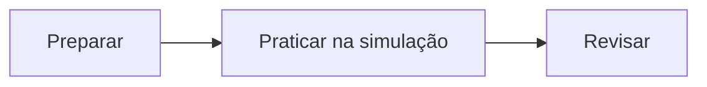

# Curso de Trading — Wiki com SDD e Pareto

Curso prático de scalping e day trade **100% em USD**, exclusivamente em
índices globais **US100, US500, US30**, Forex **EURUSD, GBPUSD, USDJPY** e
metais **XAUUSD (ouro)**. O Módulo 01 reúne quatro aulas de fundamentos,
MetaTrader 5, conta Demo e ordem a mercado protegida; o Módulo 02 apresenta uma
estratégia simples e o Módulo 03 conduz sua repetição controlada, sempre com o
Diário de bordo.

## Escopo definitivo e módulos disponíveis

Conta, risco, custos, margem e resultados usam USD. Unidades do contrato e moedas
nativas de cotação continuam identificadas; símbolos/sufixos e especificações
dependem do servidor. Tabelas hipotéticas não substituem a ficha do símbolo.

O [Módulo 01](docs/modulo-01/index.md) segue 1.1 unidades → 1.2 MT5 → 1.3 Demo →
1.4 execução e proteção. Protocolo didático: Demo em USD, saldo inicial fixo de
USD 1000, teto estimado de 1% do capital líquido por trade incluindo custos,
uma posição por vez e SL/TP antes do envio. One-Click desligado para entradas.
Se mínimo, contrato ou proteção forem incompatíveis, não executar. Não há
promessa de resultado ou recomendação desses parâmetros para conta real.

[Spec, Plan e Tasks do módulo](specs/002-fundamentos-mt5/spec.md) documentam
assinaturas de papel, hipóteses e vetos. A constituição 2.1.0 rege todos os
incrementos; nenhuma entrega termina com veto aberto.
A emenda de saldo fixo está em [specs/004-demo-usd-1000](specs/004-demo-usd-1000/spec.md).

**Regra de toda rodada:** entradas dos cinco especialistas → **Spec → Plan →
Tasks → Implementação → Validação**, sempre com filtro Pareto 80/20.

**Regra visual obrigatória (constituição 2.1.0):** toda aula e página didática
da Wiki deve explicar seu fluxo, cadeia, dinâmica ou relações em uma representação
visual. **Lucas Andrade é o responsável**, Helena Costa revisa a aprendizagem e
Diego Silveira verifica cobertura/renderização. Preferir Mermaid; mapas, gráficos
ou imagens anotadas são válidos com descrição acessível. Cada visual é seguido
de `**Como ler:**`; uma tabela isolada não substitui essa representação.
`npm run check` verifica todas as páginas recursivamente, inclusive as futuras.

**Controle de bordo:** o [Diário de bordo](docs/pratica/diario-bordo.md) e a
[planilha XLSX reutilizável](docs/public/pratica/diario-bordo.xlsx) acompanham todos
os módulos. Cada módulo deve referenciar esse mesmo registro antes de criar
novos campos ou métricas.

## Executar localmente

Requer Node.js 22 LTS e npm. Na raiz do projeto:

```sh
npm ci
npm run docs:dev
```

Abra a URL informada pelo VitePress, normalmente `http://localhost:5173`.
No PowerShell com execução de scripts restrita, use `npm.cmd` no lugar de `npm`;
não é necessário mudar a política do sistema.

Confira também o próprio modo de desenvolvimento: a página inicial deve exibir
o diagrama, a busca por “checklist” deve encontrar os modelos, e os links para
“Comece aqui” e “Modelos” devem abrir. A configuração prepara Mermaid para o
navegador durante o desenvolvimento. Após mudanças nessa configuração, aguarde
o reinício automático do servidor e recarregue com `Ctrl+F5` para descartar
módulos antigos em cache. Build aprovado não substitui essa conferência.

```sh
npm run check
npm run docs:preview
```

`check` gera o site, verifica links internos pelo VitePress e executa os smoke
tests. `docs:preview` serve o build já gerado. Saída: `docs/.vitepress/dist/`.
Não abra o HTML por `file://`: use um servidor HTTP para testar busca e módulos.

## Publicar imagem no GitHub e instalar no EasyPanel

O workflow [`docker-image.yml`](.github/workflows/docker-image.yml) constrói o
`Dockerfile` e publica automaticamente no GitHub Container Registry quando a
branch `main` ou uma tag `v*` é enviada. O GitHub guarda o código no repositório;
o EasyPanel instala a imagem publicada no GHCR.

Depois do primeiro push, use no EasyPanel:

```text
ghcr.io/OWNER/REPOSITORY:latest
```

Substitua `OWNER/REPOSITORY` pelo caminho exibido no pacote do GitHub. Configure
a porta interna `80` e, se o painel permitir, o healthcheck `GET /healthz`.
Para pacote privado, informe no EasyPanel um token do GitHub com `read:packages`;
nunca coloque esse token no repositório. Para facilitar a instalação sem
credencial, torne o pacote GHCR público nas configurações do GitHub.

## Convocar a equipe no Codex

AGENTS.md é a instrução global. Os nomes abaixo selecionam prompts locais;
não instalam agentes persistentes nem comandos do aplicativo. Diga qual rodada
deve receber a contribuição, por exemplo:

```text
Rafael Mendes, leia prompts/equipe/rafael-trading.md e produza sua entrada
de especificação para specs/005-contexto-liquidez-usd/spec.md, aplicando Pareto.
```

| Nome | Arquivo | Contribuição principal |
| --- | --- | --- |
| Rafael Mendes | [rafael-trading.md](prompts/equipe/rafael-trading.md) | Mercado, mecânica, fontes e precisão |
| Helena Costa | [helena-pedagogia.md](prompts/equipe/helena-pedagogia.md) | Objetivos, pré-requisitos e evidências |
| Camila Rocha | [camila-risco-pratica.md](prompts/equipe/camila-risco-pratica.md) | Planos, checklists, risco e diário |
| Lucas Andrade | [lucas-editorial.md](prompts/equipe/lucas-editorial.md) | Clareza, estrutura e glossário |
| Diego Silveira | [diego-sdd-devops.md](prompts/equipe/diego-sdd-devops.md) | Consolidação SDD, Wiki e infraestrutura |
| Orquestrador de Incremento | [orquestrador-incremento.md](prompts/equipe/orquestrador-incremento.md) | Rodada completa e revisão cruzada |

Para os outros especialistas, use a mesma frase substituindo nome e arquivo.
Para uma rodada completa:

```text
Orquestrador de Incremento, leia prompts/equipe/orquestrador-incremento.md.
Conduza o incremento 007-repeticao-controlada: repetir a estratégia do Módulo 02
e revisar aderência com o Diário de bordo.
Colete as cinco entradas, aplique Pareto e execute Spec → Plan → Tasks →
Implementação → Validação. Use apenas o menor escopo de alto impacto.
```

As cinco perspectivas podem ser executadas sequencialmente. Seus nomes são
papéis editoriais; não indicam pessoas reais ou revisões humanas independentes.

## Desenvolver qualquer incremento

Leia a [constituição](.specify/memory/constitution.md) e o
[guia da adaptação Spec-Kit](.specify/README.md). A rodada inicial está em
[specs/001-bootstrap](specs/001-bootstrap/spec.md).

1. Escolha o próximo número livre e crie `specs/NNN-nome/`.
2. Copie o template de Spec e recolha as cinco contribuições. Cada uma define
   requisitos, aceites, escopo, restrições e filtro Pareto. Se não houver impacto
   em uma área, registre a justificativa em sua seção.
3. Consolide a Spec, resolva bloqueantes e derive o Plan rastreável.
4. Derive Tasks atômicas, ordenadas por impacto P0/P1 e dependência.
5. Implemente somente então. Alterou o escopo? Atualize os três artefatos antes
   do trabalho dependente. Novas aulas podem partir do template de aula.
6. Revise precisão, aprendizagem, risco, editorial e infraestrutura; rode
   `npm run check`. Registre evidências reais e pendências em `validation.md`.
7. Publique o commit validado no destino autorizado e confira a Wiki no domínio.

Exemplo de preparação no PowerShell, usando um número ainda livre:

```powershell
New-Item -ItemType Directory -Path specs/005-contexto-liquidez-usd
Copy-Item .specify/templates/spec-template.md specs/005-contexto-liquidez-usd/spec.md
# Preencher e consolidar Spec antes de derivar o plano.
Copy-Item .specify/templates/plan-template.md specs/005-contexto-liquidez-usd/plan.md
# Consolidar Plan antes de derivar tarefas e implementar.
Copy-Item .specify/templates/tasks-template.md specs/005-contexto-liquidez-usd/tasks.md
```

80/20 significa priorizar o essencial e registrar cortes e gatilhos de retorno;
não é promessa de lucro nem proporção estatística garantida. O bootstrap adota
os artefatos do Spec-Kit; o CLI e seus slash commands não são pré-requisitos
instalados deste repositório. Veja a [documentação oficial](https://github.github.com/spec-kit/).

## Editar a Wiki

Conteúdo fica em `docs/`, navegação em `docs/.vitepress/config.mts` e modelos de
autoria em `.specify/templates/`. Use links Markdown relativos para outras
páginas; VitePress verifica destinos no build. Não exponha especificações,
prompts ou registros privados como páginas de alunos.

Busca local indexa o conteúdo no build e funciona no navegador sem conta ou
serviço de busca externo. O tema padrão oferece menu móvel, sumário e temas
claro/escuro. As funcionalidades seguem a
[documentação do VitePress 1.x](https://vuejs.github.io/vitepress/v1/).

Callouts e diagramas podem ser escritos assim:

````markdown
::: tip O essencial
Uma decisão prática por destaque.
:::



Prepare o exercício, pratique na simulação e revise o registro.
````

Inclua explicação textual do diagrama. O
[plugin Mermaid](https://github.com/emersonbottero/vitepress-plugin-mermaid)
renderiza os blocos no navegador; os módulos necessários fazem parte do build.
Não há CDN configurada pelo projeto.

## Testar o container

Requer Docker com daemon ativo e suporte a containers Linux. Não use o servidor
de desenvolvimento em produção.

```sh
docker build -t curso-trading:local .
docker run -d --name curso-trading-check -p 127.0.0.1:8080:80 curso-trading:local
docker inspect --format='{{.State.Health.Status}}' curso-trading-check
```

A saúde começa em `starting`; repita a inspeção após o primeiro intervalo do
healthcheck (30 segundos). O resultado esperado é `healthy`. No PowerShell:

```powershell
(Invoke-WebRequest http://localhost:8080/ -UseBasicParsing).StatusCode
(Invoke-WebRequest http://localhost:8080/comece-aqui -UseBasicParsing).StatusCode
(Invoke-WebRequest http://localhost:8080/pratica/modelos -UseBasicParsing).StatusCode
(Invoke-WebRequest http://localhost:8080/healthz -UseBasicParsing).Content
curl.exe -s -o NUL -w "%{http_code}" http://localhost:8080/rota-inexistente
docker logs curso-trading-check
docker rm -f curso-trading-check
```

Resultados esperados: `200`, `200`, `200`, `ok` e `404`. Antes de remover o
container, confira no navegador a busca por “checklist”, um resultado com link,
menu em tela estreita, navegação por teclado e o diagrama na página inicial.
Se o daemon não estiver ativo, o teste Docker está pendente; build do site
sozinho não comprova execução do container.

## Publicar e atualizar no Easypanel por Git

O runtime é Nginx Alpine na **porta interna 80**, com `GET /healthz` retornando
`200`/`ok`. O Dockerfile é multi-stage: Node compila e Nginx recebe somente os
arquivos estáticos. Não há variáveis obrigatórias, banco, volumes ou credenciais
de aplicação. Tags de imagens base devem ser revistas em incrementos próprios.

1. Rode `npm ci` e `npm run check`. Inicialize Git se necessário (`git init -b
   main`), revise os arquivos, faça commit e envie ao seu repositório remoto.
   Preserve `package-lock.json` no commit.
2. No projeto do Easypanel, crie um serviço **App**. Em **Source**, escolha
   **GitHub** ou **Git**, informe repositório, branch (`main`, se adotada) e
   Build Path `/`. Configure acesso privado no painel quando necessário.
3. Em **Build**, selecione **Dockerfile**, caminho `Dockerfile`, contexto na raiz.
   O build executa a compilação; não configure um comando de desenvolvimento.
4. Em **Domains**, configure hostname e destino **HTTP, porta 80**. Habilite HTTPS
   no proxy e aponte o DNS conforme o domínio utilizado. Um domínio de serviço
   automático também precisa apontar à porta correta.
5. Clique **Deploy**, acompanhe o build e logs e confira `/healthz`, páginas,
   busca e menu no domínio. O healthcheck Docker roda dentro do container;
   ele não configura, por si só, um monitor externo do proxy.
6. Para atualizar, passe o incremento por SDD e validação, faça commit/push e
   clique **Deploy**. Com fonte GitHub, **Auto Deploy** pode acionar o webhook;
   habilite apenas quando a branch publicada já tiver passado na CI. Em Git
   genérico, use redeploy manual ou a integração disponível no painel.
7. Registre URL, commit e data em `validation.md`. Para rollback, reverta o
   commit defeituoso via Git, envie a reversão e faça novo deploy. Valide saúde,
   rotas e busca novamente; confirme no log que o commit correto foi compilado.

O roteiro acompanha a [documentação oficial do serviço App](https://easypanel.io/docs/services/app).
A CI deste projeto **valida** cada PR e push em `main`; ela não publica. Proteja
a branch publicada com o check obrigatório se ativar deploy automático.
Não coloque tokens, chaves de deploy ou URLs secretas de webhook no repositório.

## Árvore do projeto

```text
.
├── AGENTS.md
├── README.md
├── .editorconfig
├── .gitignore
├── .dockerignore
├── .github/workflows/wiki.yml
├── .specify/
│   ├── README.md
│   ├── memory/constitution.md
│   └── templates/
│       ├── spec-template.md
│       ├── plan-template.md
│       ├── tasks-template.md
│       └── aula-template.md
├── prompts/equipe/
│   ├── rafael-trading.md
│   ├── helena-pedagogia.md
│   ├── camila-risco-pratica.md
│   ├── lucas-editorial.md
│   ├── diego-sdd-devops.md
│   └── orquestrador-incremento.md
├── specs/
│   ├── 001-bootstrap/
│   ├── 002-correcao-dev/
│   └── 002-fundamentos-mt5/  # spec.md, plan.md, tasks.md, validation.md
├── docs/
│   ├── .vitepress/config.mts
│   ├── index.md
│   ├── comece-aqui.md
│   ├── trilha.md
│   ├── pratica/modelos.md
│   ├── modulo-01/
│   │   ├── index.md
│   │   ├── 1-1-terreno-usd.md
│   │   ├── 1-2-mt5-essencial.md
│   │   ├── 1-3-conta-demo.md
│   │   └── 1-4-ordem-mercado.md
│   └── referencias/
│       ├── glossario.md
│       └── fontes.md
├── docker/nginx.conf
├── Dockerfile
├── package.json
├── package-lock.json
└── tests/
    ├── wiki.test.mjs
    └── fundamentos-mt5.test.mjs
```

O estado do Módulo 01 está no
[relatório de validação da conta USD 1.000](specs/004-demo-usd-1000/validation.md)
e no [relatório-base do módulo](specs/002-fundamentos-mt5/validation.md); o
[bootstrap](specs/001-bootstrap/validation.md) e a
[correção do desenvolvimento](specs/002-correcao-dev/validation.md) preservam
suas evidências históricas. O módulo está integrado à Wiki local; isso não
implica deploy remoto ou operação realizada em nome do aluno.
