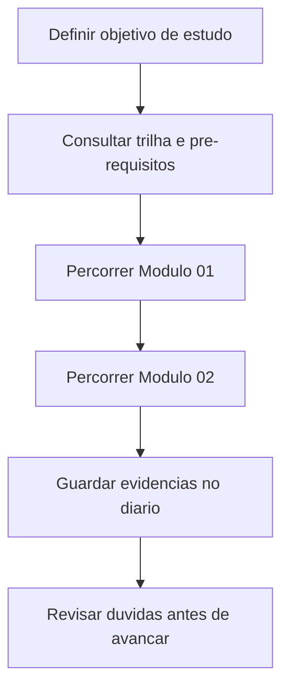

# Comece aqui

**Seu objetivo agora é preparar o estudo e começar os Módulos 01 e 02.** Use os modelos
para registrar a prática exclusivamente em conta Demo em USD. A primeira ordem
ocorre na aula 1.4, depois de unidades, terminal e risco conferidos.

## Prepare o estudo

1. Consulte o [estado da trilha](trilha.md). Separe conteúdo disponível de aulas
   que ainda serão desenvolvidas.
2. Escolha um alvo por vez entre índices US100/US500/US30, Forex
   EURUSD/GBPUSD/USDJPY e ouro XAUUSD; contrato e sufixo dependem do servidor.
3. Copie o [plano, checklist e diário](pratica/modelos.md) para um arquivo privado.
   Os campos sem resposta são dúvidas a resolver antes do exercício. Siga
   [1.1 → 1.2 → 1.3 → 1.4](modulo-01/index.md), sem antecipar ordens. Depois,
   siga [2.1 → 2.2 → 2.3 → 2.4](modulo-02/index.md) para estudar uma estratégia
   simples e depois [3.1 → 3.2 → 3.3 → 3.4](modulo-03/index.md) para repeti-la.
4. Use o [glossário](referencias/glossario.md) e a busca no topo para localizar
   termos. Na tela pequena, abra “Menu do curso” para navegar.

::: tip Um objetivo por sessão de estudo
Registre o que você pretende conseguir fazer e qual evidência mostrará que
conseguiu. Exemplo de estudo: “Localizar o contrato correto na fonte oficial e
anotar onde conferir suas características”.
:::

## Seu caminho de estudo

**Como ler:** defina o objetivo, confira os pré-requisitos e siga as aulas na
ordem. Guarde evidências e resolva dúvidas antes de avançar; enviar ordens
depende dos gates Demo, risco e proteção ensinados no módulo.

## Registre a preparação

| Campo | Sua resposta |
| --- | --- |
| Mercado que quero estudar primeiro | A preencher |
| Objetivo observável da próxima sessão | A preencher |
| Fonte oficial que preciso consultar | A preencher |
| Dúvida que impede o exercício | A preencher |
| Evidência que vou guardar | A preencher |

Não envie extratos, credenciais ou dados financeiros pessoais para o repositório.
Os modelos publicados são formulários vazios para uso individual.

## Confira antes de avançar

- [ ] Consigo localizar a trilha, os modelos e o glossário.
- [ ] Sei quais aulas estão disponíveis e quais ainda estão planejadas.
- [ ] Tenho um objetivo de estudo e um lugar privado para registrar a prática.
- [ ] Sei onde buscar fontes e quais dúvidas ainda preciso resolver.

Essa conferência conclui apenas a preparação de estudo. O Módulo 01 ensina o
protocolo básico; o Módulo 02 apresenta uma estratégia simples e o Módulo 03
ensina a repeti-la sem trocar as regras.

**Próximo passo:** [aula 1.1 — o terreno em dólar](modulo-01/1-1-terreno-usd.md).
