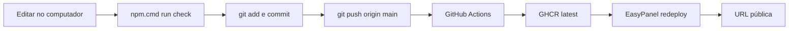

# Publicar nova versão e atualizar a Wiki

::: tip Resumo Pareto
Edite localmente, rode o check, envie para `main`, aguarde o GitHub Actions e
reimplante a imagem `latest` no EasyPanel. A URL pública é o teste final.
:::

## O fluxo completo



**Como ler:** cada versão passa pelo check antes do push; o workflow constrói a
imagem, o GHCR recebe `latest` e o EasyPanel precisa reiniciar o serviço para
baixar a imagem nova.

## 1. Alterar e validar localmente

Faça as mudanças na Wiki e confira o estado:

```powershell
git status
npm.cmd run check
```

O `check` precisa terminar com build aprovado e todos os testes passando. Não
publique uma versão com teste vermelho.

## 2. Criar a versão no GitHub

```powershell
git add .
git commit -m "Descrever a atualização"
git push origin main
```

O workflow **Publicar imagem Docker** será acionado. Ele publica:

```text
ghcr.io/kratos4ai/curso-trading-wiki:latest
```

Abra a aba **Actions** do repositório e espere a execução ficar verde. O workflow
de validação da Wiki também precisa passar.

## Checklist de validação em camadas

| Camada | Pergunta | Evidência | Se falhar |
| --- | --- | --- | --- |
| Local | O build e os testes passam? | `npm.cmd run check` verde | Corrigir antes do commit |
| GitHub | Os dois workflows passaram? | Dois checks verdes em **Actions** | Abrir o log da etapa vermelha |
| GHCR | A tag nova existe? | `latest` ou `sha-*` no pacote | Conferir permissão `packages: write` |
| EasyPanel | O serviço baixou a imagem? | Deploy saudável e `/healthz` | Fazer redeploy e revisar credencial |
| Internet | A página atual abriu? | URL pública e navegação | Verificar logs e cache |

Use a primeira camada que falhar como ponto de investigação. Não pule direto
para o EasyPanel quando o problema ainda está no código ou no workflow.

## 3. Atualizar no EasyPanel

No serviço da Wiki:

1. Confirme a imagem `ghcr.io/kratos4ai/curso-trading-wiki:latest`.
2. Clique em **Redeploy**, **Deploy** ou equivalente.
3. Aguarde o download da imagem e o serviço ficar saudável.
4. Mantenha a porta interna `80` e o healthcheck `GET /healthz`.

Se o pacote GHCR for privado, o serviço precisa de uma credencial com
`read:packages`. Não coloque esse token neste repositório.

## 4. Conferir a publicação

Abra a URL pública:

[https://trading-agent-curso-trading.hkjpsr.easypanel.host/](https://trading-agent-curso-trading.hkjpsr.easypanel.host/)

Confirme a página inicial, a navegação, a busca e uma aula com Mermaid. Use
`Ctrl+F5` se o navegador mantiver arquivos antigos em cache.

## Sacadas que evitam retrabalho

- **Código, imagem e serviço são coisas diferentes:** o commit é a fonte, a
  imagem GHCR é o pacote e o EasyPanel é o processo em execução.
- **Action verde não significa site atualizado:** ela confirma o build e o push;
  o redeploy confirma que o servidor baixou a imagem nova.
- **`latest` facilita a rotina; `sha-*` facilita o rollback:** use `latest` para
  o caminho normal e guarde o SHA do commit publicado no registro da versão.
- **Uma mudança por vez ajuda a diagnosticar:** publique alterações pequenas e
  descreva o que mudou no commit.

## Conceitos essenciais

- **Workflow:** receita executada pelo GitHub Actions.
- **GHCR:** registro que armazena as imagens Docker do GitHub.
- **Tag:** nome que aponta para uma versão da imagem, como `latest` ou `sha-*`.
- **Redeploy:** ordem para o EasyPanel parar o processo atual e iniciar outro
  usando a imagem configurada.
- **Healthcheck:** teste simples que confirma que o Nginx está respondendo.

## Registro leve de cada publicação

Copie este bloco para a descrição do commit, issue ou diário do projeto:

```text
Data:
Commit:
O que mudou:
Actions: verde / pendente / falhou
Imagem: ghcr.io/kratos4ai/curso-trading-wiki:latest
EasyPanel: redeploy concluído / pendente
URL pública: conferida / pendente
Rollback necessário: não / sha-________
```

## Reverter uma versão

Se a versão nova apresentar problema, pare o serviço e volte temporariamente
para uma tag de commit anterior publicada pelo workflow, no formato:

```text
ghcr.io/kratos4ai/curso-trading-wiki:sha-XXXXXXXX
```

Depois corrija o código, rode o check e publique uma nova versão por `main`.

**Próximo passo:** registrar no Diário de bordo ou no histórico do projeto o que
foi alterado e o resultado da conferência pública.
