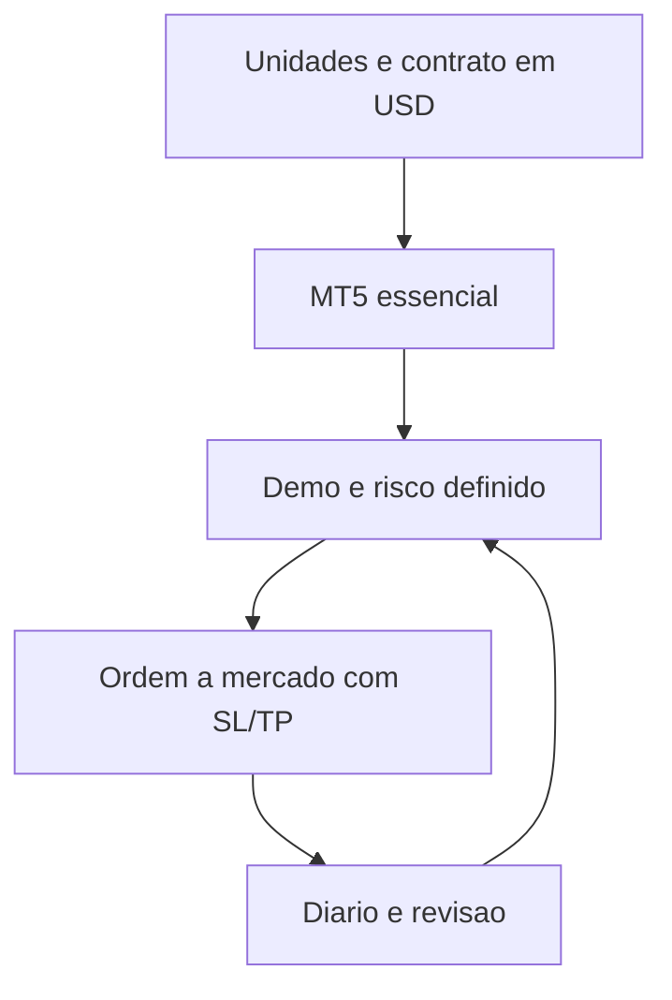

# Curso de Trading em USD

**Estude o essencial, pratique na Demo e revise suas decisões.** Scalping e day
trade em índices globais **US100, US500, US30**, Forex **EURUSD, GBPUSD, USDJPY**
e metais **XAUUSD (ouro)**, com conta, custos, risco e resultados em USD.

::: info Módulo 01 disponível
Quatro aulas completas: unidades e valores financeiros, MetaTrader 5 essencial,
Demo realista e ordem a mercado com Stop Loss e Take Profit. Comece pelo
[Módulo 01 — Fundamentos em USD e MT5](modulo-01/index.md).
:::

::: info Módulo 02 disponível
Uma estratégia simples de nível, confirmação e proteção, praticada na mesma
Demo de USD 1.000. Comece pelo [Módulo 02 — Estratégia simples](modulo-02/index.md).
:::

::: info Módulo 03 disponível
Repetição controlada da mesma estratégia, com registros comparáveis no Diário de
bordo. Comece pelo [Módulo 03 — Repetição controlada](modulo-03/index.md).
:::

## Seu primeiro passo

| Você precisa… | Vá para |
| --- | --- |
| Preparar o estudo | [Comece aqui](comece-aqui.md) |
| Entender lotes, pips, pontos e margem | [Aula 1.1](modulo-01/1-1-terreno-usd.md) |
| Configurar o MT5 | [Aula 1.2](modulo-01/1-2-mt5-essencial.md) |
| Criar uma Demo em USD e calcular 1% | [Aula 1.3](modulo-01/1-3-conta-demo.md) |
| Praticar uma ordem protegida | [Aula 1.4](modulo-01/1-4-ordem-mercado.md) |
| Estudar a estratégia simples | [Módulo 02](modulo-02/index.md) |
| Repetir e revisar o processo | [Módulo 03](modulo-03/index.md) |
| Registrar e revisar decisões | [Plano, checklist e diário](pratica/modelos.md) |
| Conferir próximos módulos | [Trilha](trilha.md) |

## A jornada prática

**Como ler:** identifique unidades e contrato; prepare MT5 e Demo; calcule o risco
antes da ordem protegida e use o diário para revisar a próxima sessão.

::: warning Regras do laboratório
Somente Demo em USD, saldo inicial fixo de USD 1000, teto estimado de 1% do capital
líquido por trade com custos e uma posição por vez. SL/TP antes do envio;
One-Click desligado para entradas. Parâmetros didáticos não garantem perda
máxima nem resultados. Se a proteção ou o volume não couberem, não execute.
:::

**Próximo passo:** [prepare seu estudo](comece-aqui.md) e abra a
[primeira aula](modulo-01/1-1-terreno-usd.md).
