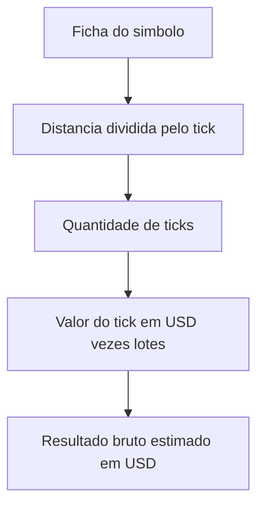

# Aula 1.1 — O Terreno de Jogo em Dólar

::: tip Resumo Pareto
Um lote não vale o mesmo nos três mercados. Leia a Especificação do símbolo e
converta cada movimento em USD antes de pensar em volume ou margem.
:::

## Objetivo e pré-requisitos

Ao concluir, distinguir pip, ponto e tick e calcular o custo de um spread.
Pré-requisito: [orientação de estudo](../comece-aqui.md) e multiplicação/divisão.

## Os três mercados e suas unidades

O curso cobre índices **US100, US500, US30**, Forex **EURUSD, GBPUSD, USDJPY**
e metais **XAUUSD (ouro)**. Um símbolo de índice no MT5 pode ser um CFD com
contrato definido pelo servidor; seu nome não informa o valor do lote.

- **Pip:** convenção de variação: EURUSD/GBPUSD, `0.0001`; USDJPY, `0.01`.
  Não aplicar essa convenção automaticamente a índice ou ouro.
- **Ponto MT5:** unidade de cotação `SYMBOL_POINT`, ligada às casas decimais.
  EURUSD com cinco casas tem ponto `0.00001`: dez desses pontos formam um pip.
- **Tick de preço:** menor incremento permitido (`SYMBOL_TRADE_TICK_SIZE`).
  Pode diferir do ponto. “Tick” também pode significar uma atualização da cotação.
- **Spread:** Ask − Bid. Compra entra pelo Ask e sai pelo Bid; venda faz o
  inverso. O spread é um custo de atravessar esses preços.

Em Observação do Mercado, abra o menu do símbolo → **Especificação**. Registre
contrato, casas/ponto, tick, valor de tick, moeda de lucro/margem, mínimo/passo de
volume, modo de cálculo e distância mínima de SL/TP. Consulte a
[documentação dos campos](https://www.mql5.com/en/docs/constants/environment_state/marketinfoconstants).

## Da unidade ao resultado

**Como ler:** confira a ficha, converta a distância em ticks e multiplique por
valor do tick e volume. O resultado é bruto; custos e regras do servidor devem
ser considerados separadamente. Margem é outro cálculo.

## Uma tabela, nove tamanhos de posição

**Cenário hipotético; não é ficha universal de corretora.** Ponto decimal nas
tabelas segue a convenção do MT5. Hipóteses por lote:

| Símbolo | Contrato | Cotação suposta | Ponto / tick | Movimento-base |
| --- | --- | --- | --- | --- |
| EURUSD | 100000 unidades da moeda-base | 1.10000 | 0.00001 / 0.00001 | 1 pip = 0.0001 |
| US100 | USD 1 por ponto de índice | 20000 | 0.1 / 0.1 | 1 ponto de índice = 1.0 |
| XAUUSD | 100 onças troy | 3000 | 0.01 / 0.01 | 1.00 USD/onça |

Somente neste cenário: mínimo/passo de lote `0.01`; margem linear = nocional/100
(alavancagem ilustrativa 1:100, sem recomendação). Exposição-base significa
unidades-base, equivalentes de contrato e onças, respectivamente.

| Símbolo | Lote | Exposição-base | USD/movimento-base | USD/tick | Nocional USD | Margem USD |
| --- | --- | --- | --- | --- | --- | --- |
| EURUSD | 0.01 | 1000 | 0.10 | 0.01 | 1100 | 11 |
| EURUSD | 0.10 | 10000 | 1.00 | 0.10 | 11000 | 110 |
| EURUSD | 1.00 | 100000 | 10.00 | 1.00 | 110000 | 1100 |
| US100 | 0.01 | 0.01 | 0.01 | 0.001 | 200 | 2 |
| US100 | 0.10 | 0.10 | 0.10 | 0.01 | 2000 | 20 |
| US100 | 1.00 | 1.00 | 1.00 | 0.10 | 20000 | 200 |
| XAUUSD | 0.01 | 1 | 1.00 | 0.01 | 3000 | 30 |
| XAUUSD | 0.10 | 10 | 10.00 | 0.10 | 30000 | 300 |
| XAUUSD | 1.00 | 100 | 100.00 | 1.00 | 300000 | 3000 |

Em tela pequena, role a tabela para o lado para conferir nocional e margem.

Valores por movimento/tick são magnitudes de resultado bruto: a direção decide
ganho ou perda. Subcentavos podem ser arredondados na conta. O servidor pode
usar outro contrato, mínimo, tick ou regime de margem: **sua ficha prevalece**.

## Nocional, margem e risco são diferentes

Nocional é a exposição; margem é garantia reservada. Aumentar alavancagem pode
reduzir margem exigida, mas não reduz o resultado por movimento do mesmo lote.
Margem não limita perda. Confira o método efetivo do símbolo/servidor.

Estimativa: `USD = distância / tick × valor_tick_em_USD_por_lote × lotes`.
Use valor apropriado ao lado/perda se houver diferenças. USDJPY mantém sua moeda
nativa de cotação; a conta e o resultado precisam ser convertidos para USD.

## Exemplo e exercício

EURUSD hipotético: Bid `1.10000`, Ask `1.10020`. Spread = `0.00020` = dois pips.
Em `0.10` lote, a marcação inicial é aproximadamente **−USD 2**, sem comissão
ou slippage. Não é uma cotação atual.

**Faça:** calcule o resultado bruto de um movimento adverso de 10.0 pontos de
índice em US100 `0.10` lote e compare com a margem ilustrativa.

**Resposta:** `10 × USD 0.10 = USD 1` de perda bruta; margem `USD 20`.
São medidas diferentes. Depois, preencha sua ficha; dados ausentes impedem prática.

## Confira antes de avançar

- [ ] Expliquei por que pip, ponto MT5 e ponto de índice não são intercambiáveis.
- [ ] Recalculei o spread e o exercício, identificando hipóteses e unidades.
- [ ] Sei que só aplicarei valores à Demo após conferir o símbolo real.

## Fontes e próximo passo

Consulta em **2026-11-21**: [Especificação MT5](https://www.metatrader5.com/en/terminal/help/trading/market_watch),
[OrderCalcProfit](https://www.mql5.com/en/docs/trading/ordercalcprofit) e
[OrderCalcMargin](https://www.mql5.com/en/docs/trading/ordercalcmargin).
Os números são hipóteses próprias do exercício.

**Próximo:** [aula 1.2 — MT5 essencial](1-2-mt5-essencial.md).
