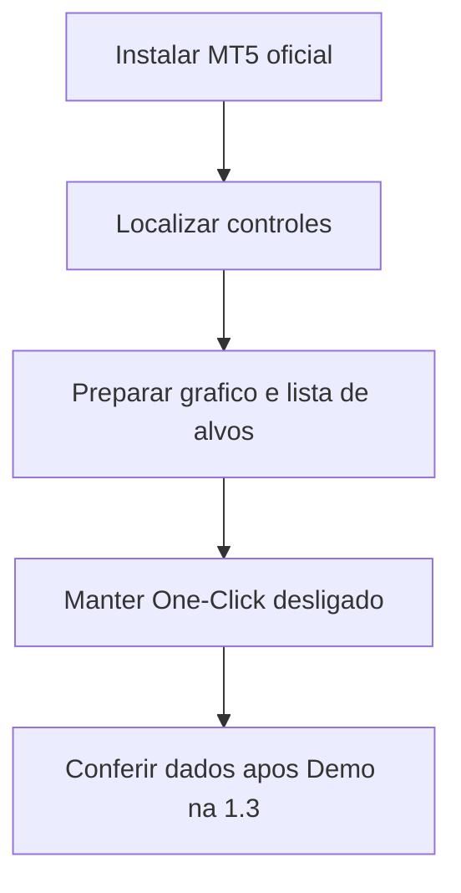

# Aula 1.2 — MetaTrader 5 Essencial

::: tip Resumo Pareto
Mantenha um gráfico, Bid/Ask, Observação do Mercado e Caixa de Ferramentas.
Reconheça o One-Click, mas deixe suas entradas desabilitadas: rapidez não
substitui Stop Loss e Take Profit definidos antes do envio.
:::

## Objetivo e pré-requisitos

Localizar os controles do terminal, preparar uma apresentação limpa e explicar
o risco do clique imediato. Pré-requisito: [aula 1.1](1-1-terreno-usd.md).
Nenhuma ordem será enviada nesta aula.

## Fluxo de preparação do terminal

**Como ler:** prepare o ambiente e reconheça seus controles antes de negociar.
Sem conexão, o reconhecimento é offline; a Demo da próxima aula permite
conferir dados e terminar o layout. Nenhuma etapa autoriza envio de ordem aqui.

## Instale o terminal correto

1. Baixe **MetaTrader 5 Desktop para Windows** no
   [site oficial](https://www.metatrader5.com/en/download) ou no portal oficial
   do servidor Demo que você pretende usar. Confira nome e origem do instalador.
2. Execute o instalador, conclua a instalação e abra o terminal. Os nomes dos
   menus podem mudar com idioma/versão; procure a função equivalente.
3. Não selecione conta real nem deposite dinheiro. A abertura e a validação
   da conta Demo são o assunto da [aula 1.3](1-3-conta-demo.md).
4. Se ainda não houver conexão/cotações, reconheça os menus offline. Complete
   a conferência dos símbolos e do gráfico após configurar a Demo na próxima aula.

## Deixe visível apenas o necessário

Use **Exibir → Observação do Mercado** e **Exibir → Caixa de Ferramentas**.
A aba **Negociação** da Caixa de Ferramentas será usada para posições e conta.

Com a Demo conectada, na Observação do Mercado:

- Feche gráficos desnecessários; no menu da lista, oculte símbolos não usados.
  Símbolos com gráfico/posição/ordem podem não permitir ocultação; não feche uma
  posição só para limpar a tela.
- Adicione apenas os alvos disponíveis: **US100, US500, US30, EURUSD, GBPUSD,
  USDJPY, XAUUSD**. Sufixos podem variar; confira a descrição, não só o nome.
  Se um alvo não existir, registre indisponibilidade, sem substituir por outro.
- Mostre Bid, Ask e spread. Salve esse conjunto de símbolos quando disponível.
- Abra o gráfico pelo menu do símbolo; evite duplo clique casual, que pode
  abrir a janela de ordem. Abra **Especificação** para preencher sua ficha.

## Um gráfico limpo

No menu do gráfico → **Propriedades**, escolha candles, fundo/cores com contraste,
retire a grade e deixe visíveis linhas de Bid e Ask e níveis de negociação.
Remova indicadores extras; mantenha um gráfico, por exemplo M5 apenas para
observar a interface, sem tratá-lo como sinal. Salve um template “Curso-USD”.

Não adicione robôs, sinais, indicadores ou painéis pagos. Você precisa enxergar
preço, símbolo, spread e proteção; o restante pode esperar.

## One-Click: conheça o risco antes de ativar

O painel One-Click oferece Buy/Sell com volume e pode enviar ordens sem diálogo
adicional. Exibir o painel não significa que ele preencha SL/TP automaticamente.

Em **Ferramentas → Opções → Negociação**, mantenha a função de negociação com
um clique desabilitada. Oculte também o painel pelo menu do gráfico. Neste
módulo, use **F9/Nova Ordem** na aula 1.4, com proteção preenchida antes do envio.
Não experimente os botões Buy/Sell só para verificar se funcionam.

## Faça e confira

**Entregável:** checklist de interface. Sem cotações, registre quais controles
localizou e deixe a conferência do símbolo para a etapa final da aula 1.3.

- [ ] Localizei Observação do Mercado, Caixa de Ferramentas e Especificação.
- [ ] Preparei ou identifiquei as opções do template sem indicadores extras.
- [ ] Mantive One-Click desabilitado e não enviei ordens.
- [ ] Sei que um gráfico limpo não torna uma entrada segura ou lucrativa.

**Pergunta:** um painel Buy/Sell visível garante SL/TP? **Resposta:** não; deve-se
preencher a ordem protegida pelo diálogo e conferir a posição após execução.

## Fontes e próximo passo

Consulta em **2026-11-21**: [gráficos](https://www.metatrader5.com/en/terminal/help/charts_advanced/charts_settings),
[Observação do Mercado](https://www.metatrader5.com/en/terminal/help/trading/market_watch),
[One-Click](https://www.metatrader5.com/en/terminal/help/trading/one_click_trading) e
[opções do terminal](https://www.metatrader5.com/en/terminal/help/startworking/settings).

**Próximo:** [aula 1.3 — Demo realista](1-3-conta-demo.md).
