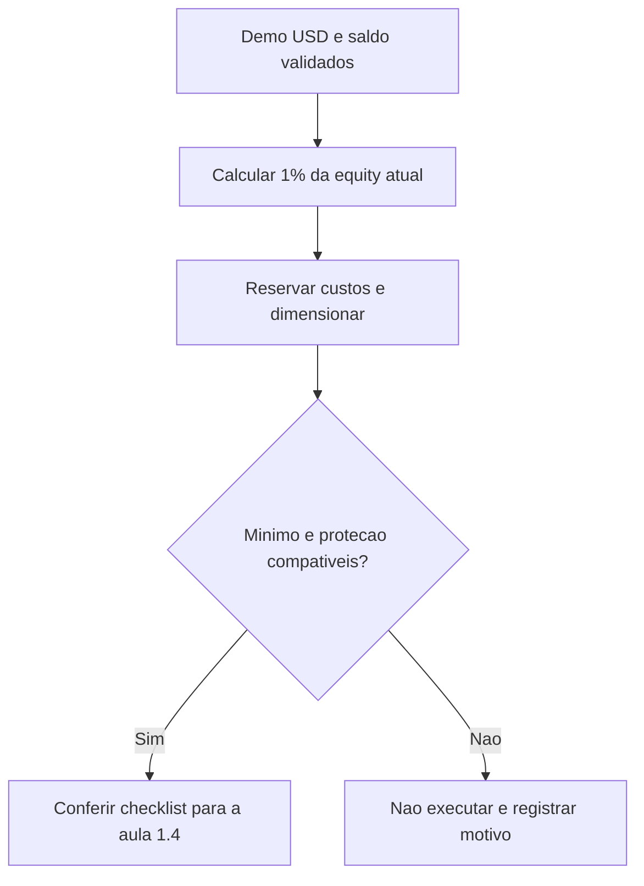

# Aula 1.3 — Conta Demo com Mentalidade Real

::: tip Resumo Pareto
Use uma única Demo em USD com saldo inicial de **USD 1000**. Nesta prática, limite o
risco estimado de cada trade a 1% do capital líquido, incluindo custos, e aceite
não executar quando o lote mínimo ou a proteção forem incompatíveis.
:::

## Objetivo e pré-requisitos

Confirmar o ambiente Demo, calcular um orçamento em USD e completar o checklist
de preparação. Pré-requisitos: [unidades](1-1-terreno-usd.md) e
[terminal instalado](1-2-mt5-essencial.md). Não enviar ordens ainda.

## Da Demo ao orçamento

**Como ler:** só uma Demo em USD validada inicia o cálculo. Separe custos,
dimensione e confira mínimo e proteção. Incompatibilidade leva à não execução;
compatibilidade permite conferir o checklist, sem antecipar a ordem da aula 1.4.

## Abra a Demo e confira os parâmetros

1. No MT5, **Arquivo → Abrir uma Conta**; localize o servidor da instituição
   escolhida para treinamento. O curso não recomenda corretora nem jurisdição.
2. Selecione **conta de demonstração**, nunca conta real. Siga o formulário e
   as regras do servidor; salve credenciais em local privado.
3. Escolha um tipo de conta cuja moeda seja **USD**. A moeda pode ser determinada
   pelo tipo de conta, sem campo editável independente.
4. Selecione saldo inicial de **USD 1000**; este é o único saldo usado no
   módulo. Anote a alavancagem disponível e o regime do símbolo: ela não
   determina seu limite de perda. Não escolher alavancagem para aumentar lote.
5. Confira Demo, servidor, moeda e saldo no terminal/registro da conta. Se o
   servidor não oferecer esses parâmetros, pare e consulte seu suporte Demo;
   não substitua silenciosamente por saldo maior ou moeda diferente.
6. Conectado, finalize o conjunto de símbolos e o gráfico da aula 1.2. Confira
   a Especificação do instrumento escolhido e o mínimo/passo de volume.

## Por que não treinar com USD 100000?

Um saldo muito acima do cenário pretendido **pode distorcer a escala do treino**:
1% de USD 100000 é USD 1000, cem vezes o orçamento de uma Demo de USD 1000.
Isso facilita experimentar volumes que não cabem no exercício menor. Não é uma
lei psicológica: o problema é a falta de correspondência entre os cenários.

Mantenha o saldo inicial e registre as perdas. Não reinicie a conta para apagar
resultados. Demo não reproduz integralmente pressão, liquidez ou execução real.

## Calcule o teto didático de 1%

Use **capital líquido atual (Equity)**, não apenas o depósito inicial:

`orçamento USD = capital líquido USD × 0.01`.

| Capital líquido USD | Teto estimado de 1% em USD |
| --- | --- |
| 1000 | 10 |

Se a equity cair a USD 900, o teto passa a USD 9. Uma posição por vez neste
módulo. É um limite didático da simulação, **não uma recomendação universal**
nem garantia: gaps, slippage e custos podem ampliar a perda efetiva.

Separe uma reserva explícita para comissão e slippage. Volume teórico:

`(orçamento − reserva) / perda estimada de 1 lote até o SL`.

Arredonde **para baixo** ao passo permitido. Se ficar abaixo do mínimo, não
execute; não aproxime o stop artificialmente nem aumente o orçamento para caber.
A [aula 1.4](1-4-ordem-mercado.md) mostra a memória de cálculo completa.

## Checklist de preparação

- [ ] Confirmei Demo, USD e saldo inicial fixo USD 1000; nenhuma conta real.
- [ ] Conferi equity atual, calculei 1% e reservei custos/slippage.
- [ ] Registrei símbolo, contrato, tick, mínimo/passo e regras de proteção.
- [ ] Finalizei gráfico e lista de alvos, sem One-Click de entrada.
- [ ] Não há posição nem ordem pendente anterior no ambiente deste exercício.
- [ ] Sei interromper se faltar dado, conexão, proteção ou tamanho compatível.
- [ ] Preparei [plano e diário privados](../pratica/modelos.md).

## Exercício e critério de conclusão

**Faça:** com a equity inicial de USD 1000 e reserva de USD 2, calcule quanto
resta para a perda pelo movimento até o stop.

**Resposta:** teto USD 10; reserva USD 2; restam **USD 8**. Registre cálculo e
checklist. Campo desconhecido impede a próxima execução, mesmo com margem livre.

## Fontes e próximo passo

Consulta em **2026-11-21**: [abertura de Demo e parâmetros](https://www.metatrader5.com/en/terminal/help/startworking/acc_open),
[margem](https://www.mql5.com/en/docs/trading/ordercalcmargin) e
[propriedades do símbolo](https://www.mql5.com/en/docs/constants/environment_state/marketinfoconstants).
O saldo fixo de USD 1000 e o teto de 1% são escolhas pedagógicas do módulo.

**Próximo:** [aula 1.4 — ordem a mercado e proteção](1-4-ordem-mercado.md).
