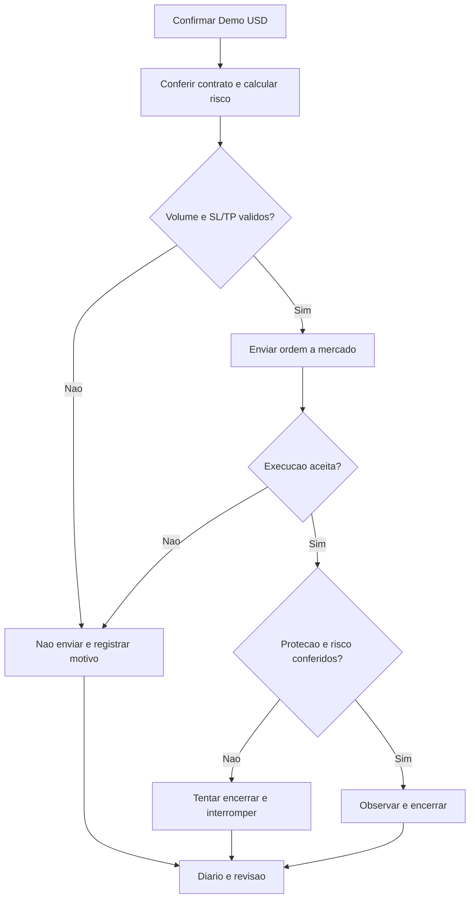

# Aula 1.4 — Execução de Ordem a Mercado e Proteção

::: tip Resumo Pareto
Confira Demo, contrato e risco; preencha Stop Loss e Take Profit antes do envio.
Uma ordem a mercado pede execução disponível, não garante o preço visto na tela.
Sem proteção inicial ou volume compatível, a decisão correta é não executar.
:::

## Objetivo e pré-requisitos

Dimensionar uma ordem, explicar spread e saldos e registrar execução protegida
ou não execução. Pré-requisitos: aulas [1.1](1-1-terreno-usd.md),
[1.2](1-2-mt5-essencial.md) e checklist [1.3](1-3-conta-demo.md) completo.

## Buy/Sell Market e a proteção

**Buy Market** compra; **Sell Market** vende. Em Forex/CFD, compra costuma entrar
pelo Ask e sair pelo Bid; venda entra pelo Bid e sai pelo Ask. Cotações mudam e
pode haver slippage/rejeição. Não clicar repetidamente após atraso: primeiro
confira se já há posição ou negócio no histórico.

Na compra, SL fica abaixo e TP acima da entrada; na venda, inversamente.
Respeite a distância mínima e o tick do servidor. SL/TP são níveis de proteção,
não garantia de preço ou resultado. Confira como o servidor dispara e executa.

## Exemplo hipotético em USD

Use apenas para aritmética; **não replique os preços como ordem atual**.
Contrato EURUSD da [tabela 1.1](1-1-terreno-usd.md):

| Parâmetro | Valor do exercício |
| --- | --- |
| Capital líquido / orçamento de 1% | USD 1000 / USD 10 |
| Reserva de comissão e slippage | USD 2 |
| Bid / Ask de entrada | 1.10000 / 1.10020 |
| Stop Loss / Take Profit de compra | 1.09820 / 1.10420 |
| Distância até SL / até TP | 20 pips / 40 pips |
| Perda bruta em 1.00 lote até SL | USD 200 |
| Volume calculado e permitido no cenário | 0.04 lote |
| Perda bruta / reserva / total estimado | USD 8 / USD 2 / USD 10 |

Conta: `(10 − 2) / (20 × 10) = 0.04 lote`. O spread de dois pips provoca
marcação inicial aproximada de **−USD 0,80**, antes de comissão. Como a distância
ao SL usa Ask de entrada e preço Bid de saída, **não some o spread novamente**.
O TP equivale a USD 40 brutos nesse cenário; não é meta ou vantagem comprovada.

## Exercício guiado: envie somente se elegível

1. Confirme **Demo/USD**, nenhuma outra posição/ordem e orçamento atual de 1%.
   Abra [plano e diário](../pratica/modelos.md).
2. Escolha um alvo disponível; anote cotações atuais, contrato, tick e custos.
   Defina níveis hipotéticos de treino e refaça a conta com dados da sua Demo.
3. Pressione **F9/Nova Ordem**, confira símbolo/sufixo, volume e tipo de execução
   disponível. **Market Execution** usa os botões Buy/Sell by Market; outros
   modos podem mostrar nomes diferentes. Não selecionar ordem pendente.
4. Preencha **SL e TP válidos antes do envio**, conferindo se o campo usa preço
   ou distância em pontos. Confira a perda estimada em USD,
   reserva e volume arredondado para baixo. Se o servidor impedir proteção
   junto à entrada, exigir volume incompatível ou faltar dado: **não enviar**.
5. Somente com todos os campos conferidos, envie **uma** ordem na Demo. Em
   Negociação, confira execução, preço, lote e SL/TP efetivamente registrados.
6. Se a posição surgir sem proteção, tente **encerramento imediato**, registre
   incidente e interrompa. Se não conseguir fechar, acione suporte Demo; não
   aumente posição. Se o preço executado elevar o risco além do orçamento,
   encerre o exercício e registre a divergência, sem afastar o stop.
7. Observe o resultado flutuante; encerre pelo procedimento de fechar posição
   ou proteção. Não use um Buy/Sell oposto como substituto de fechamento:
   contas hedging podem abrir outra posição. Registre custos e resultado.

## Saldo, capital líquido e margem livre

Em **Caixa de Ferramentas → Negociação**:

- **Saldo (Balance):** resultado contabilizado, sem o resultado flutuante.
- **Capital líquido (Equity):** incorpora flutuação e ajustes do servidor.
  Sem crédito/bloqueios, é aproximadamente saldo + resultado flutuante líquido.
- **Margem:** garantia reservada. **Margem livre:** em geral equity − margem,
  conforme regras da conta; não é orçamento de perda permitido.

Exemplo simplificado sem crédito/comissão: saldo USD 1000, resultado −USD 0,80,
equity USD 999,20, margem USD 44; margem livre **USD 955,20**. Não use esse valor
para aumentar o lote.

## Ciclo da ordem

**Como ler:** confirme Demo e cálculo; bloqueie envio incompatível; após aceitar a execução,
confira proteção e risco. Falha exige tentativa de encerramento e interrupção;
todo caminho termina em registro e revisão, inclusive a não execução.

## Confira antes de avançar

- [ ] Expliquei −USD 0,80 iniciais, orçamento USD 10 e volume 0,04 do exemplo.
- [ ] Diferenciei saldo, equity e margem livre e encontrei USD 955,20 no exercício.
- [ ] Registrei ticket, horário/fuso, preenchimento, SL/TP, custos e resultado,
  ou motivo verificável de não execução. Comparei planejado e observado.

## Fontes e próximo passo

Consulta em **2026-11-21**: [execução e estado da conta](https://www.metatrader5.com/en/terminal/help/trading/performing_deals),
[ordem, negócio e posição](https://www.metatrader5.com/en/terminal/help/trading/general_concept),
[OrderCalcProfit](https://www.mql5.com/en/docs/trading/ordercalcprofit).

**Próximo:** [revise o Diário de bordo](../pratica/diario-bordo.md) e
[o modelo de diário](../pratica/modelos.md#diario-da-decisao) e
[confira a conclusão do módulo](index.md#conclusao-do-modulo). Não há passagem automática para conta real.
