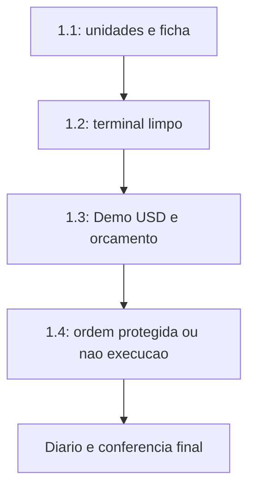

# Módulo 01 — Fundamentos em USD, MetaTrader 5 e Ordem a Mercado

::: tip Resumo Pareto
Aprenda unidades, prepare o terminal, valide a Demo e só então pratique uma
ordem protegida. O objetivo é executar e explicar o processo, não obter lucro.
:::

## A cadeia do módulo

**Como ler:** cada aula prepara a seguinte. As unidades orientam a configuração;
a Demo e o orçamento precedem a decisão de executar com proteção ou não
executar. O diário e a conferência final fecham o laboratório.

## O que você vai entregar

Uma ficha do símbolo, um ambiente MT5 limpo, um checklist Demo e um diário de
execução protegida ou de não execução justificada. Requer aritmética básica e
a leitura de [Comece aqui](../comece-aqui.md). Use também o
[Diário de bordo](../pratica/diario-bordo.md) para guardar a evidência.

| Ordem | Aula disponível | Objetivo observável | Entrega |
| --- | --- | --- | --- |
| 1.1 | [O terreno de jogo em dólar](1-1-terreno-usd.md) | Distinguir pip, ponto e tick; calcular valor financeiro | Ficha e cálculo de spread |
| 1.2 | [MT5 essencial](1-2-mt5-essencial.md) | Localizar controles, preparar gráfico e reconhecer One-Click | Checklist do terminal |
| 1.3 | [Demo com mentalidade real](1-3-conta-demo.md) | Confirmar Demo/USD e calcular o teto didático de 1% | Checklist de preparação |
| 1.4 | [Ordem a mercado e proteção](1-4-ordem-mercado.md) | Dimensionar, conferir SL/TP e registrar uma decisão | Diário com memória de cálculo |

## Regras do laboratório

- Conta **Demo em USD**, saldo inicial fixo em **USD 1000**.
- Uma posição por vez; orçamento estimado por trade de **no máximo 1% do capital
  líquido atual**, incluindo custos e reserva de slippage.
- **Stop Loss e Take Profit antes do envio**; One-Click desligado para entradas.
- Se mínimo de lote, proteção ou dados forem incompatíveis, **não executar**.

Esses são parâmetros didáticos deste módulo. Não constituem recomendação para
conta real nem garantia de perda máxima. Não é necessário enviar uma ordem
para demonstrar aprendizagem quando os critérios de não execução se aplicarem.

Escopo: índices US100/US500/US30, Forex EURUSD/GBPUSD/USDJPY e ouro XAUUSD.
Símbolos/sufixos e contratos variam por servidor. Os números das aulas são
hipotéticos; registre os parâmetros reais de sua Demo antes de praticar.

## Conclusão do módulo

- [ ] Recalculei unidades, spread e exemplos de risco com a resposta conferida.
- [ ] Preparei a ficha do símbolo, o terminal e o checklist Demo/USD.
- [ ] Entreguei diário e memória de cálculo da execução protegida, ou um motivo
  verificável de não execução quando um gate impediu a prática.

Explique uma diferença entre o cenário hipotético e sua Demo. Se houver um
campo desconhecido, retorne à aula correspondente; não improvise a resposta.
Essa conferência conclui o laboratório, sem certificar vantagem ou prontidão
para conta real.

**Comece pela [aula 1.1](1-1-terreno-usd.md).**
