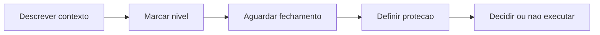

# Aula 2.1 — A estratégia em quatro passos

::: tip Resumo Pareto
O modelo é nível + confirmação + proteção. Ele organiza uma hipótese para
estudo; não prevê o próximo preço e não elimina risco.
:::

> Estado: publicada · Spec: 005 · Revisão: 2026-11-21

## Objetivo e pré-requisitos

Ao final, explique o fluxo em voz alta e identifique em qual passo uma ficha
foi interrompida. Pré-requisitos: Módulo 01, Demo USD 1.000 e gráfico limpo.

## O modelo sem enfeite

1. **Contexto:** descreva o que o período mais amplo mostra, sem escrever
   “vai subir” ou “vai cair”.
2. **Nível:** marque uma linha horizontal que o preço já respeitou no gráfico.
3. **Confirmação:** espere um fechamento que seja coerente com a hipótese; toque
   ou pavio isolado não basta para este exercício.
4. **Proteção:** defina invalidação, Stop Loss, Take Profit, volume e orçamento
   antes de considerar a ordem. Se algum campo faltar, não execute.

**Como ler:** cada caixa depende da anterior. A linha é uma referência, o
fechamento testa a hipótese e a proteção limita o plano. O fluxo não diz qual
lado comprar ou vender.

## Exemplo hipotético

Em um gráfico EURUSD, você registra “faixa observada entre dois níveis” e marca
o limite superior. Se uma vela fecha além dele, isso é apenas confirmação da
hipótese escolhida; ainda faltam distância de invalidação, custos, volume e os
gates da Demo. Se a ficha do servidor não couber no plano, registre não execução.

## Faça na simulação

1. Abra um alvo permitido na Demo, sem One-Click.
2. Escreva uma frase de contexto sem usar previsão.
3. Desenhe um único nível horizontal e escreva o que invalidaria a hipótese.
4. Pare antes da ordem e confira se consegue explicar os quatro passos.

**Rubrica:** aprovado se a ficha contém os quatro passos, uma invalidação e uma
decisão de espera ou não execução. Não aprovado se houver promessa de resultado,
indicador ou ordem sem proteção.

## Fontes e próximo passo

Consulta em **2026-11-21**: [gráficos e períodos do MT5](https://www.metatrader5.com/en/terminal/help/charts_analysis/charts)
e [linhas horizontais](https://www.metatrader5.com/en/terminal/help/objects/lines).

**Próximo:** [2.2 — contexto e nível](2-2-contexto-nivel.md).
