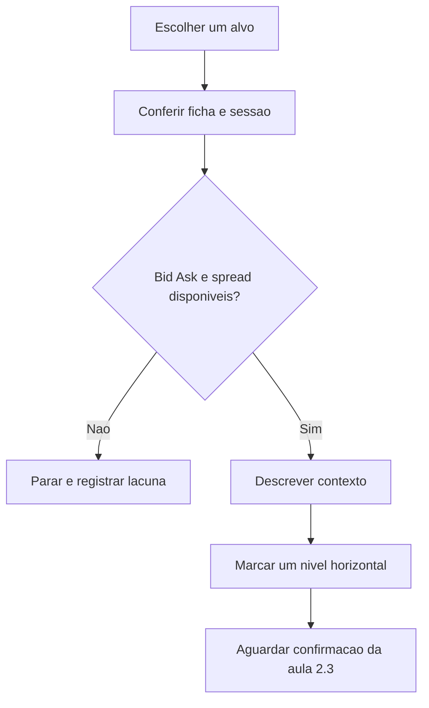

# Aula 2.2 — Contexto, spread e nível

::: tip Resumo Pareto
Antes de interpretar o nível, confira período, Bid/Ask, spread, sessão e ficha
do símbolo. Contexto ruim ou dado ausente pede espera, não improviso.
:::

> Estado: publicada · Spec: 005 · Revisão: 2026-11-21

## Objetivo e pré-requisitos

Montar uma ficha de contexto e marcar um nível horizontal sem indicador.
Pré-requisito: [2.1](2-1-estrategia-simples.md) e o terminal do Módulo 01.

## O filtro antes do nível

No **Observação do Mercado**, confira o símbolo completo, Bid, Ask, spread e
horário do servidor. Abra **Especificação** e anote dígitos, ponto, stops level,
volume mínimo/passo e sessões. No gráfico, escolha um período amplo para
descrever a faixa ou sequência observada e uma janela menor apenas para localizar
o nível. Não transforme esses dados em previsão.

**Como ler:** a ficha vem antes do desenho. Se Bid, Ask, spread ou sessão não
estiverem claros, o fluxo termina em registro. O nível organiza a observação;
não autoriza uma ordem.

## Liquidez sem adivinhação

O spread muda conforme servidor e momento. Depth of Market não é necessário neste
módulo: se aparecer no terminal, marque “não utilizado” e não o transforme em
critério. A estratégia continua baseada no nível, confirmação e proteção.

## Faça na simulação

1. Selecione um único alvo da lista do curso e confirme o sufixo.
2. Copie para a ficha horário, Bid, Ask, spread, sessão e fonte.
3. Descreva o período amplo em uma frase e desenhe apenas um nível.
4. Tire uma captura privada ou anote o preço; não envie ordem nesta aula.

**Rubrica:** aprovado se a ficha tem fonte/horário, dados do servidor, uma frase
sem previsão e um nível identificável. Dado ausente ou hipótese confusa exige
parada.

## Fontes e próximo passo

Consulta em **2026-11-21**: [Market Watch](https://www.metatrader5.com/en/terminal/help/trading/market_watch),
[propriedades do símbolo](https://www.mql5.com/en/docs/constants/environment_state/marketinfoconstants)
e [configuração de Bid/Ask no gráfico](https://www.metatrader5.com/en/terminal/help/charts_advanced/charts_settings).

**Próximo:** [2.3 — confirmação e risco](2-3-confirmacao-risco.md).
