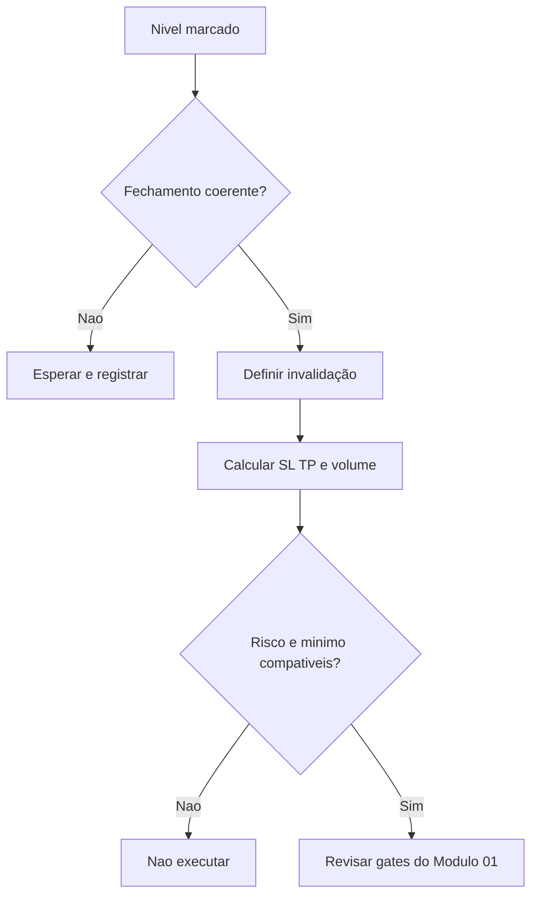

# Aula 2.3 — Confirmação, invalidação e risco

::: tip Resumo Pareto
Um nível só entra no plano depois de um fechamento coerente com a hipótese.
Depois vêm invalidação, SL/TP, volume e orçamento; sem essa sequência, não
execute.
:::

> Estado: publicada · Spec: 005 · Revisão: 2026-11-21

## Objetivo e pré-requisitos

Distinguir toque de confirmação e preencher a ficha de risco antes de qualquer
ordem. Pré-requisitos: [2.2](2-2-contexto-nivel.md), Módulo 01 e Demo USD 1.000.

## Esperar é uma ação

Depois de marcar o nível, aguarde o fechamento da vela. Um toque, um pavio ou um
movimento visto no meio da vela não confirma o modelo. Se o fechamento não for
coerente com a hipótese registrada, mantenha a ficha como “esperar” e não ajuste
o nível para forçar uma entrada.

**Como ler:** confirmação não elimina o risco. Ela apenas libera a próxima
conferência; o fluxo ainda pode terminar em não execução por cálculo, proteção,
spread ou regra do servidor.

## Risco na Demo de USD 1.000

Use o teto didático já aprendido: 1% da equity inicial equivale a USD 10.
Reserve custos e slippage, arredonde o volume para baixo e confira o mínimo do
servidor. Não aumente lote, alavancagem ou orçamento para fazer o modelo caber.
Consulte a memória de cálculo da [aula 1.4](../modulo-01/1-4-ordem-mercado.md).

## Faça na simulação

1. Volte à ficha da aula 2.2 e registre “confirmado” ou “não confirmado”.
2. Para “confirmado”, escreva nível de invalidação, SL, TP, volume e reserva.
3. Confira Demo/USD, uma posição, One-Click desligado e SL/TP antes do envio.
4. Se qualquer campo falhar, marque **não executar** e explique o motivo.

**Rubrica:** aprovado se a decisão é reproduzível a partir da ficha e não excede
o orçamento. Confirmação sem proteção, custo ou unidade é veto de Camila.

## Fontes e próximo passo

Consulta em **2026-11-21**: [Market Watch e spread](https://www.metatrader5.com/en/terminal/help/trading/market_watch)
e [propriedades do símbolo](https://www.mql5.com/en/docs/constants/environment_state/marketinfoconstants).

**Próximo:** [2.4 — prática guiada](2-4-pratica-guiada.md).
