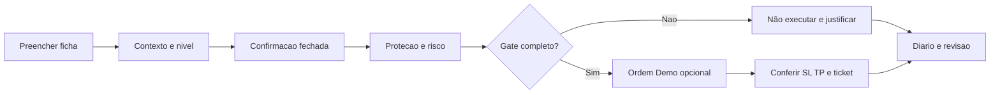

# Aula 2.4 — Prática guiada e diário

::: tip Resumo Pareto
Faça uma única ficha completa, escolha executar ou não executar e registre o
que realmente aconteceu. A qualidade da decisão vale mais que abrir uma ordem.
:::

> Estado: publicada · Spec: 005 · Revisão: 2026-11-21

## Objetivo e pré-requisitos

Aplicar o fluxo de nível + confirmação + proteção em uma sessão de Demo e
produzir um registro revisável. Pré-requisitos: aulas 2.1–2.3 e checklist do
[Módulo 01](../modulo-01/index.md).

## Uma sessão, uma decisão

Escolha um alvo permitido e não troque de símbolo para recuperar uma hipótese
que falhou. Use o mesmo gráfico limpo, uma posição no máximo e o orçamento de 1%
da equity. Nenhum resultado simulado prova vantagem futura.

**Como ler:** “opcional” significa que a ordem não é necessária para concluir
o exercício. O caminho sem execução é correto quando um gate falha ou quando a
hipótese não se confirma; ambos terminam no mesmo diário.

## Passo a passo

1. Registre data, horário do servidor, símbolo, período e fonte.
2. Descreva contexto, marque um nível e anote o spread observado.
3. Aguarde o fechamento e classifique a confirmação sem editar o passado.
4. Se confirmada, complete invalidação, SL, TP, volume, reserva e orçamento.
5. Só se todos os gates do Módulo 01 passarem, uma ordem protegida de Demo pode
   ser considerada. Caso contrário, encerre como não execução.
6. Registre preço, ticket, custos, proteção e resultado; ou registre o motivo
   verificável da parada.

## Rubrica de conclusão

- [ ] Um alvo e uma ficha, sem troca para recuperar perda.
- [ ] Contexto, nível, confirmação e invalidação estão escritos.
- [ ] Demo USD 1.000, risco, SL/TP e volume foram conferidos.
- [ ] A decisão e a diferença entre planejado e observado estão no diário.

Falha em qualquer item não exige nova ordem: exige revisão da ficha. O próximo
conteúdo pode estudar amostra e estatística somente depois de vários registros,
em Spec própria.

## Fontes e próximo passo

Consulta em **2026-11-21**: [execução protegida no MT5](https://www.metatrader5.com/en/terminal/help/trading/performing_deals)
e [linhas do gráfico](https://www.metatrader5.com/en/terminal/help/objects/lines).

**Próximo:** use o [Diário de bordo](../pratica/diario-bordo.md), consulte os
[modelos](../pratica/modelos.md) e aguarde o próximo módulo de revisão.
