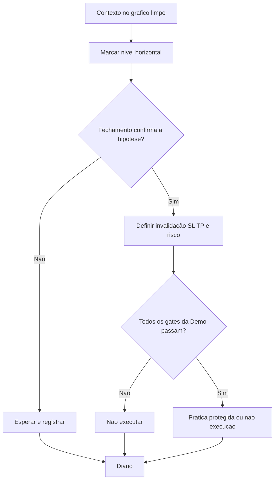

# Módulo 02 — Estratégia simples: nível, confirmação e proteção

::: tip Resumo Pareto
Use um único fluxo: contexto → nível horizontal → confirmação → proteção.
Se um passo faltar, espere ou não execute. A estratégia é um exercício em Demo,
não uma promessa de direção ou resultado.
:::

## O fluxo do módulo

**Como ler:** o nível não é entrada. A confirmação vem depois, e a proteção
vem antes de qualquer ordem. O diário registra espera, não execução ou prática
protegida; nenhum caminho certifica vantagem.

## O que você vai entregar

Uma ficha curta com contexto, nível, confirmação, invalidação, custos e decisão.
Use a mesma Demo em USD 1.000 do Módulo 01 e um alvo por vez entre US100, US500,
US30, EURUSD, GBPUSD, USDJPY e XAUUSD. Registre tudo no
[Diário de bordo](../pratica/diario-bordo.md).

| Aula | Objetivo observável | Entrega |
| --- | --- | --- |
| 2.1 | Explicar os quatro passos sem prever preço | Cartão da estratégia |
| 2.2 | Marcar contexto e um nível horizontal | Captura/anotação privada |
| 2.3 | Definir confirmação, invalidação e risco | Ficha de decisão |
| 2.4 | Aplicar o fluxo e justificar a decisão | Diário revisado |

## Regras simples

- Não usar indicador, setup alternativo ou ordem pendente neste módulo.
- Demo USD 1.000, uma posição por vez e teto didático de 1% da equity.
- SL/TP antes do envio; One-Click desligado; dado ausente significa parar.
- A prática pode terminar em não execução. Isso também é evidência válida.

**Próximo passo:** [2.1 — a estratégia em quatro passos](2-1-estrategia-simples.md).
