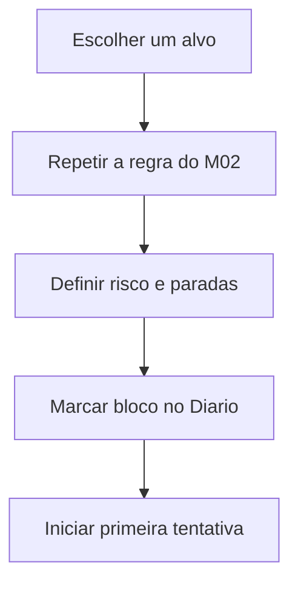

# Aula 3.1 — Preparar um bloco sem trocar as regras

::: tip Resumo Pareto
Um bloco é um compromisso curto com um alvo e uma regra. Defina o que não vai
mudar antes de começar e use o Diário de bordo para tornar isso visível.
:::

> Estado: publicada · Spec: 007 · Revisão: 2026-11-21

## Objetivo e pré-requisitos

Preencher o cartão do bloco e declarar alvo, período, estratégia e risco antes da
primeira tentativa. Pré-requisitos: Módulos 01 e 02 e planilha XLSX do [Diário de
bordo](../pratica/diario-bordo.md).

## O cartão do bloco

Registre na primeira linha ou em uma nota privada: símbolo/sufixo, período,
estratégia **nível + confirmação + proteção**, Demo USD 1.000, teto de 1%,
condições de parada e marco de 10 registros. Não escolha um segundo alvo para
compensar uma hipótese que falhou.

**Como ler:** o bloco começa antes do gráfico. Se alvo, regra ou risco não
estiverem claros, a ação correta é adiar e registrar a dúvida.

## Faça na simulação

1. Abra uma cópia do XLSX e identifique o bloco pela data e pelo alvo.
2. Escreva o que conta como confirmação e o que invalida a hipótese.
3. Confirme o teto de 1%, reserva, SL/TP e condição de não execução.
4. Pare. A próxima aula registra a tentativa; não antecipe uma ordem.

**Rubrica:** aprovado se outra pessoa consegue entender qual regra será repetida,
qual ativo está em foco e quando a prática deve parar.

## Fontes e próximo passo

Consulta em **2026-11-21**: [Diário de bordo](../pratica/diario-bordo.md) e
[estratégia do Módulo 02](../modulo-02/index.md).

**Próximo:** [3.2 — registrar a tentativa](3-2-registrar-tentativa.md).
