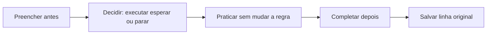

# Aula 3.2 — Registrar antes, decisão e depois

::: tip Resumo Pareto
Uma linha completa vale mais que uma memória vaga. Preencha antes da decisão,
complete depois e mantenha a linha mesmo quando a decisão for esperar.
:::

> Estado: publicada · Spec: 007 · Revisão: 2026-11-21

## Objetivo e pré-requisitos

Completar uma linha do Diário de bordo sem alterar a regra durante a tentativa.
Pré-requisito: [3.1](3-1-preparar-bloco.md) e uma cópia da planilha.

## Três momentos da linha

**Antes:** data/hora, aula, símbolo, contexto, nível, confirmação esperada,
equity, orçamento, reserva e decisão planejada.

**Decisão:** executar, esperar ou não executar. Se esperar, escreva o que falta;
se executar, todos os gates do Módulo 01 continuam obrigatórios.

**Depois:** volume, resultado bruto, custos, resultado líquido, regra seguida,
motivo de parada e aprendizado. Não transforme o resultado em justificativa
retroativa para a decisão.

**Como ler:** a linha é uma fotografia da informação disponível naquele momento.
O resultado posterior não pode reescrever o contexto anterior.

## Faça na simulação

1. Use uma linha por tentativa ou não execução.
2. Deixe o resultado vazio quando não houver ordem; escreva o motivo.
3. Confira que orçamento e resultado estão em USD e que custos não foram
   omitidos.
4. Salve a planilha ao final da sessão, sem apagar linhas anteriores.

**Rubrica:** aprovado se a linha permite reconstruir decisão, risco e diferença
entre planejado e observado. Uma linha sem motivo ou custo conhecido fica como
lacuna para revisão.

## Fontes e próximo passo

Consulta em **2026-11-21**: [Diário de bordo](../pratica/diario-bordo.md) e
[modelos de prática](../pratica/modelos.md).

**Próximo:** [3.3 — revisar aderência](3-3-revisar-aderencia.md).
