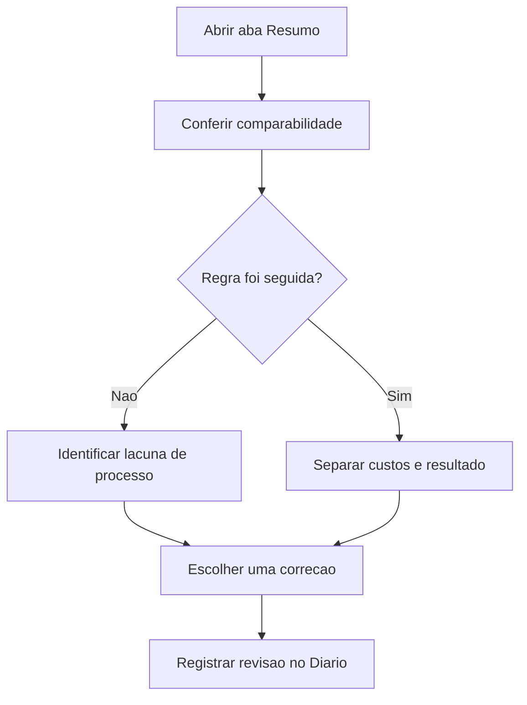

# Aula 3.3 — Revisar aderência antes do lucro

::: tip Resumo Pareto
Abra a aba Resumo depois de um bloco. Primeiro veja se a regra foi seguida e
onde houve parada; resultado financeiro isolado não decide a estratégia.
:::

> Estado: publicada · Spec: 007 · Revisão: 2026-11-21

## Objetivo e pré-requisitos

Produzir uma revisão curta de um bloco, separando aderência, execução, custos e
resultado. Pré-requisito: linhas do [Diário de bordo](../pratica/diario-bordo.md).

## A pergunta certa

Não comece por “deu lucro?”. Comece por:

1. As linhas usam o mesmo alvo e regra?
2. O contexto, nível e confirmação foram registrados?
3. As paradas respeitaram risco, SL/TP e dados disponíveis?
4. O resultado líquido separa bruto e custos?
5. Qual é uma única correção de processo?

**Como ler:** aderência vem antes de resultado. Uma falha de preenchimento não é
prova de que a estratégia falhou; é informação sobre o processo a corrigir.

## Marco de 10 registros

Use 10 registros comparáveis como primeiro marco de aprendizagem. Se houver
lacunas, não complete por memória: marque-as. Dez registros ajudam a enxergar
repetição e esforço, mas não formam uma conclusão estatística ou promessa.

## Faça na simulação

1. Abra o Resumo do XLSX ao terminar o bloco.
2. Escreva três linhas: o que foi seguido, onde parou e uma correção.
3. Não troque a estratégia durante a revisão; apenas registre a decisão.

**Rubrica:** aprovado se a revisão separa processo, custos e resultado e escolhe
uma correção específica, sem selecionar apenas as melhores linhas.

## Fontes e próximo passo

Consulta em **2026-11-21**: [Diário de bordo](../pratica/diario-bordo.md).

**Próximo:** [3.4 — fechar o bloco](3-4-fechar-bloco.md).
