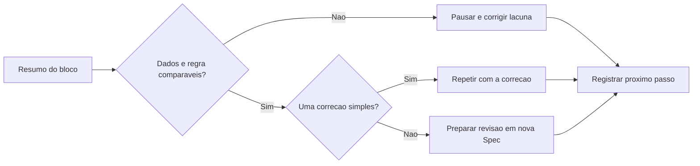

# Aula 3.4 — Fechar o bloco e escolher o próximo passo

::: tip Resumo Pareto
Feche o bloco com uma decisão pequena: repetir a mesma regra com uma correção,
pausar para resolver uma lacuna ou preparar uma Spec de revisão. Ainda não é hora
de adicionar uma segunda estratégia.
:::

> Estado: publicada · Spec: 007 · Revisão: 2026-11-21

## Objetivo e pré-requisitos

Concluir o primeiro bloco, registrar uma correção e escolher uma única ação para
a próxima sessão. Pré-requisito: revisão da [aula 3.3](3-3-revisar-aderencia.md).

## Três saídas possíveis

- **Repetir:** a regra foi seguida e há uma correção pequena de processo.
- **Pausar:** faltam dado, proteção ou compreensão; resolver antes de continuar.
- **Revisar:** o bloco está registrado, mas uma nova hipótese exige Spec própria.

**Como ler:** nenhuma saída autoriza conta real ou uma estratégia nova. O bloco
termina quando a próxima ação está escrita e pode ser conferida no Diário.

## Faça na simulação

1. Feche as linhas do bloco e salve uma cópia.
2. Registre aderência, custos, lacunas e uma correção.
3. Escolha repetir, pausar ou preparar revisão; não altere linhas passadas.
4. Leve o Diário para o próximo módulo como controle de bordo.

**Rubrica:** aprovado se a próxima ação é uma só, está justificada e não mistura
estratégias. O resultado financeiro não substitui a justificativa.

## Fontes e próximo passo

Consulta em **2026-11-21**: [Diário de bordo](../pratica/diario-bordo.md) e
[trilha](../trilha.md).

**Próximo:** aguarde o módulo de revisão; continue usando a mesma planilha.
