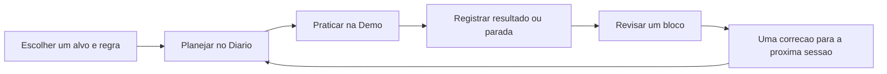

# Módulo 03 — Repetição controlada

::: tip Resumo Pareto
Não troque de estratégia ainda. Repita o fluxo do Módulo 02, registre cada
decisão no Diário de bordo e revise a aderência antes de pensar em resultado.
:::

## O ciclo do módulo

**Como ler:** a repetição usa a mesma regra e muda apenas o que foi aprendido
na revisão. O ciclo não exige abrir ordem em toda sessão; espera e não execução
também produzem dados.

## Entrega do módulo

Use o [Diário de bordo](../pratica/diario-bordo.md) e a planilha XLSX. Ao final
do primeiro bloco, procure ter **10 registros comparáveis**. Esse marco ajuda a
revisar o processo; não prova vantagem estatística.

| Aula | Objetivo | Entrega |
| --- | --- | --- |
| 3.1 | Preparar um bloco sem trocar as regras | Cartão do bloco |
| 3.2 | Registrar antes, decisão e depois | Linhas completas no Diário |
| 3.3 | Revisar aderência antes do lucro | Resumo do bloco |
| 3.4 | Fechar e escolher uma correção | Decisão para o próximo bloco |

## Regras simples

- Um alvo principal por bloco; registre símbolo e sufixo.
- Uma estratégia: nível, confirmação e proteção do Módulo 02.
- Demo USD 1.000, risco didático de 1%, SL/TP e não execução quando necessário.
- Não editar linhas antigas nem mudar a regra para recuperar uma perda.

**Próximo passo:** [3.1 — preparar o bloco](3-1-preparar-bloco.md).
