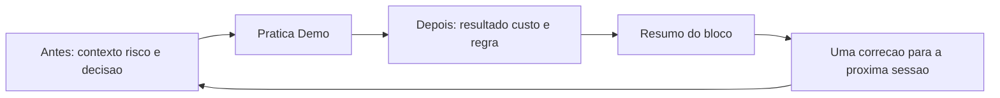

# Diário de bordo — prática e avaliação

::: tip Resumo Pareto
Preencha uma linha antes da prática, complete-a depois e revise um pequeno bloco
de registros. O objetivo inicial é consistência de processo, não provar lucro.
:::

> Estado: publicada · Spec: 006 · Revisão: 2026-11-21

## O controle de bordo

Baixe a <a href="/pratica/diario-bordo.xlsx" download>planilha Diário de bordo</a> e abra-a no Excel, Google
Sheets ou LibreOffice. Ela tem abas de Diário, Resumo e Instruções, fórmulas para
orçamento de 1%, resultado líquido, filtros e listas de decisão. Salve sua cópia
fora do repositório; nunca inclua credenciais ou dados financeiros pessoais.

**Como ler:** a mesma linha começa como plano e termina como registro. Uma
espera ou não execução também é uma decisão válida. O resumo orienta a próxima
sessão, mas não autoriza trocar de estratégia com base em um único resultado.

## Preencha em dois momentos

**Antes (cerca de dois minutos):** data/hora do servidor, módulo/aula, símbolo,
contexto, nível, confirmação, decisão, equity, orçamento, reserva e proteção.

**Depois (cerca de dois minutos):** volume, resultado bruto, custos, resultado
líquido, regra seguida, motivo de parada e um aprendizado. Se não executou,
deixe resultado vazio e escreva o motivo.

## O que a planilha calcula

- Orçamento de 1%: `equity × 0,01`.
- Resultado líquido: `resultado bruto − custos`.
- Resumo: registros, execuções, esperas/não execuções, aderência e resultado
  líquido total.

As fórmulas estão gravadas no formato interno do XLSX e devem recalcular ao
abrir. Não substitua um valor desconhecido por zero: deixe a célula vazia e
registre a lacuna.

## Como o diário acompanha os módulos

| Etapa | O que registrar | Próximo uso |
| --- | --- | --- |
| Módulo 01 | ativo, ficha, Demo, risco, SL/TP e ordem | memória de cálculo |
| Módulo 02 | contexto, nível, confirmação e invalidação | decisão da estratégia |
| Módulo 03 | repetição, resultado e aderência | revisão de um bloco |
| Próximos módulos | bloco comparável fechado | revisão mais profunda |

Não altere uma regra no meio de um bloco para melhorar um resultado. Primeiro
termine os registros comparáveis; depois revise o processo e decida se há motivo
para ajustar ou descartar a estratégia.

## Confira antes de avançar

- [ ] A linha tem objetivo, decisão e evidência.
- [ ] Equity, orçamento e custos estão em USD e vêm da ficha da Demo.
- [ ] Registrei espera/não execução quando algum gate falhou.
- [ ] Revisei o bloco sem escolher apenas os melhores resultados.

**Próximo passo:** volte aos [modelos de prática](modelos.md), pratique o
[Módulo 02](../modulo-02/index.md) e use a mesma planilha nos próximos módulos.
