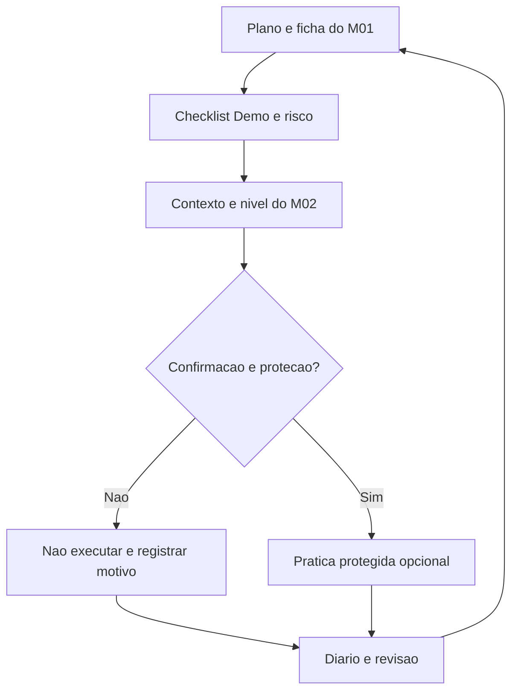

# Plano, checklist e diário

**Defina o que observar e o que registrar antes do exercício.** Copie os campos
para um arquivo privado e preencha-os quando uma aula especificar a prática.
Nos Módulos 01, 02 e 03, use Demo em USD, saldo inicial fixo de USD 1000, teto
estimado de 1% do capital líquido por trade com custos, uma posição por vez e
SL/TP antes do envio. São parâmetros didáticos, sem recomendação para conta real.

::: info Uso em simulação
Campos em aberto não são autorização para improvisar uma operação. Se um dado
necessário estiver ausente, registre a dúvida e suspenda o exercício dependente.
Confira [aula 1.3](../modulo-01/1-3-conta-demo.md),
[aula 1.4](../modulo-01/1-4-ordem-mercado.md) e o fluxo da
[estratégia simples](../modulo-02/index.md) antes de qualquer envio.
:::

::: tip Controle de bordo
Use o [Diário de bordo](diario-bordo.md) e consulte o roteiro de
[validação e operação](validacao-operacional.md). Baixe a
<a href="/pratica/diario-bordo.xlsx" download>planilha XLSX com cálculos automáticos</a>. Ela será reutilizada em
todos os módulos; esta página continua sendo a referência de campos e gates.
:::

## Do plano à revisão

**Como ler:** o plano do Módulo 01 prepara dados e risco; o Módulo 02 acrescenta
contexto, nível e confirmação. Só prossiga à prática protegida com todos os
gates conferidos. Se faltar condição, registre não execução; ambos os caminhos
voltam ao diário.

## O mesmo modelo em cada módulo

| Momento | Módulo 01 | Módulo 02 |
| --- | --- | --- |
| Preparar | Ficha do símbolo, Demo e orçamento | Contexto, período e nível |
| Decidir | SL/TP, volume e execução a mercado | Confirmação, invalidação e proteção |
| Evidência | Ticket ou não execução | Diário da hipótese e da decisão |

## Plano do exercício

| Campo | A preencher |
| --- | --- |
| Data, aula e objetivo observável | |
| Ambiente de simulação e limitações | |
| Confirmação Demo, servidor, conta USD e saldo inicial | |
| Capital líquido atual USD / orçamento de 1% USD | |
| Alvo permitido, símbolo/sufixo e unidade do contrato | |
| Fonte das características do instrumento e data da consulta | |
| Contexto e hipótese a observar | |
| Condição que invalida a hipótese | |
| Condições em que não farei o exercício | |
| Orçamento de perda hipotético e sua justificativa | |
| Preço executável previsto / SL / TP e respectivas unidades | |
| Perda estimada até SL / reserva de custos / total USD | |
| Quantidade simulada e memória de cálculo | |
| Hipóteses de custos, spread e slippage | |
| Limite da sessão/drawdown e condição de interrupção | |
| Procedimento em falha de dados ou execução | |
| Evidência que demonstra o objetivo da aula | |

Contratos não são universais. Recalcule volume com a ficha da Demo, arredonde
para baixo e não execute se o mínimo ultrapassar o orçamento. One-Click fica
desligado para entradas. Não complete dados por adivinhação.

## Checklist antes da simulação

- [ ] Sei qual aula e objetivo justificam este exercício.
- [ ] Confirmei Demo/USD, saldo inicial, equity e orçamento didático de 1%.
- [ ] Identifiquei instrumento, ambiente e fonte oficial.
- [ ] Preenchi as hipóteses de custos, quantidade e limites.
- [ ] Registrei invalidação, interrupção e quando não executar.
- [ ] Registrei contexto, nível e confirmação quando o exercício for do Módulo 02.
- [ ] Sei como registrar falhas e diferenças entre simulação e execução real.
- [ ] Tenho os pré-requisitos da aula; caso contrário, interrompi e registrei a dúvida.
- [ ] Preenchi SL/TP válidos antes do envio; não há outra posição/ordem.

## Diário da decisão

| Campo | A preencher |
| --- | --- |
| Data/hora e fuso; referência do plano | |
| Decisão: executar na simulação, esperar ou não executar | |
| Informação disponível no momento da decisão | |
| Motivo e relação com a hipótese | |
| Condição prevista versus execução observada | |
| Ticket, preço executado e SL/TP registrados na posição | |
| Quantidade e custos simulados; diferenças de preenchimento | |
| Resultado observado e unidade, quando aplicável | |
| Regra seguida ou desvio do plano | |
| Estado de atenção e pressão percebida | |
| Evidência do objetivo e dúvida para a revisão | |
| Uma correção de processo para a próxima prática | |
| Incidente de proteção/conexão e tentativa de encerramento, se houver | |

Revise decisão, execução e resultado separadamente. Um único exercício não é
amostra suficiente para concluir que existe vantagem operacional; o método de
validação será definido em módulo próprio.

**Próximo passo:** consulte o [glossário](../referencias/glossario.md), pratique
o [Módulo 02](../modulo-02/index.md) e retorne à [trilha](../trilha.md).
