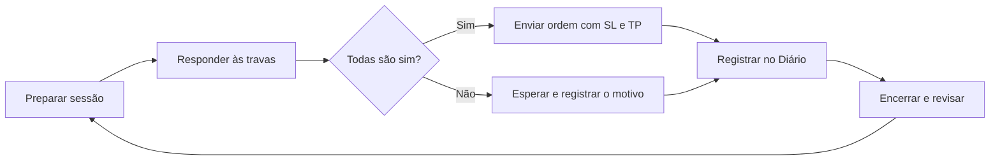

# Validação e operação — guia para começar do zero

::: tip Resumo Pareto
Você não precisa saber tudo para começar. Use a Demo, siga uma pergunta por vez,
registre o que fez e pare quando uma trava de segurança não passar.
:::

## Antes de começar

Esta página é para quem já leu o Módulo 01 e praticou a estratégia simples do
Módulo 02. Você precisa de três coisas:

1. MetaTrader 5 aberto em uma **conta Demo USD 1.000**.
2. O [Diário de bordo](diario-bordo.md) aberto.
3. Um único gráfico de US100, US500, US30, EURUSD, GBPUSD, USDJPY ou XAUUSD.

Se alguma dessas coisas ainda não estiver pronta, volte ao módulo correspondente.
Não é preciso ter conta real, saber programar ou conhecer estatística.

### Palavras que você verá

- **Ativo:** o mercado escolhido, como EURUSD ou XAUUSD.
- **Ordem:** um pedido de compra ou venda.
- **Posição:** a ordem que foi aceita e está aberta.
- **Stop Loss (SL):** proteção que encerra a posição se o preço andar contra você.
- **Take Profit (TP):** proteção que encerra a posição quando o alvo planejado é alcançado.
- **Trava de segurança (gate):** pergunta que precisa ter resposta “sim” antes da ordem.

## O ciclo leve

**Como ler:** não executar também é uma decisão correta quando uma trava falha.
O objetivo é aprender a repetir o processo, não clicar em toda sessão.

## Passo a passo operacional

### 1. Preparar

Escolha **um ativo** e observe o gráfico no período definido no Módulo 02. Escreva
uma frase simples: “Estou observando ___ porque ___”. O motivo é o **contexto**
(o que o preço está fazendo); o **nível** é o preço ou região que você marcou.

### 2. Responder às travas

Antes de clicar, marque sim ou não:

- Consigo explicar o contexto e o nível em uma frase?
- A confirmação ensinada no Módulo 02 apareceu?
- O risco estimado cabe no limite didático de 1% da conta, incluindo custos?
- O MT5 aceita o tamanho, o SL e o TP?

Uma resposta “não” encerra a tentativa. Escreva o motivo no Diário; não tente
convencer o mercado e não aumente o lote.

### 3. Executar ou esperar

Se todas as respostas forem “sim”, envie a **ordem a mercado**: o pedido é
executado pelo preço disponível naquele instante. Confira novamente o SL e o TP
antes de enviar. Se o spread (diferença entre compra e venda), a margem, o volume
mínimo ou a proteção não couberem, espere.

### 4. Registrar

Preencha uma linha do Diário antes e depois da decisão. Para começar, não deixe
em branco: data, hora do servidor, ativo e sufixo exibido no MT5, contexto,
confirmação, decisão, capital líquido, orçamento de 1%, resultado líquido e
aderência. **Aderência** significa: “segui o plano?”, mesmo que o resultado tenha
sido lucro ou perda.

### 5. Encerrar e revisar

Ao terminar, responda: “O que eu fiz conforme o plano? O que faltou?”. Depois de
10 registros comparáveis, escolha uma ação:

- **Repetir:** entendi as travas e os registros estão completos.
- **Corrigir:** encontrei uma falha operacional específica.
- **Pausar:** faltou dado, proteção ou condição segura.
- **Revisar:** existe uma dúvida que precisa ser estudada antes de continuar.

## Sacadas para aprender sem se perder

- **Resultado não vem primeiro:** uma operação com lucro pode ter quebrado o
  plano; uma perda protegida pode ter sido uma execução correta.
- **Não execução é dado:** esperar mostra onde a regra ainda está confusa e
  preserva a Demo.
- **Uma mudança por vez:** não troque ativo, período e regra ao mesmo tempo.
- **10 registros são um marco de aprendizagem:** não são prova estatística nem
  promessa de taxa de acerto.

## Seu critério de conclusão

Você terminou esta prática quando consegue, sem ajuda:

1. Explicar contexto, nível, ordem, SL e TP com suas próprias palavras.
2. Marcar as quatro travas como sim ou não e justificar um “não”.
3. Completar uma linha do Diário sem apagar uma espera ou perda.
4. Escolher entre Repetir, Corrigir, Pausar e Revisar.

**Próximo passo:** [repetir o bloco no Módulo 03](../modulo-03/index.md) usando o
mesmo Diário de bordo.
