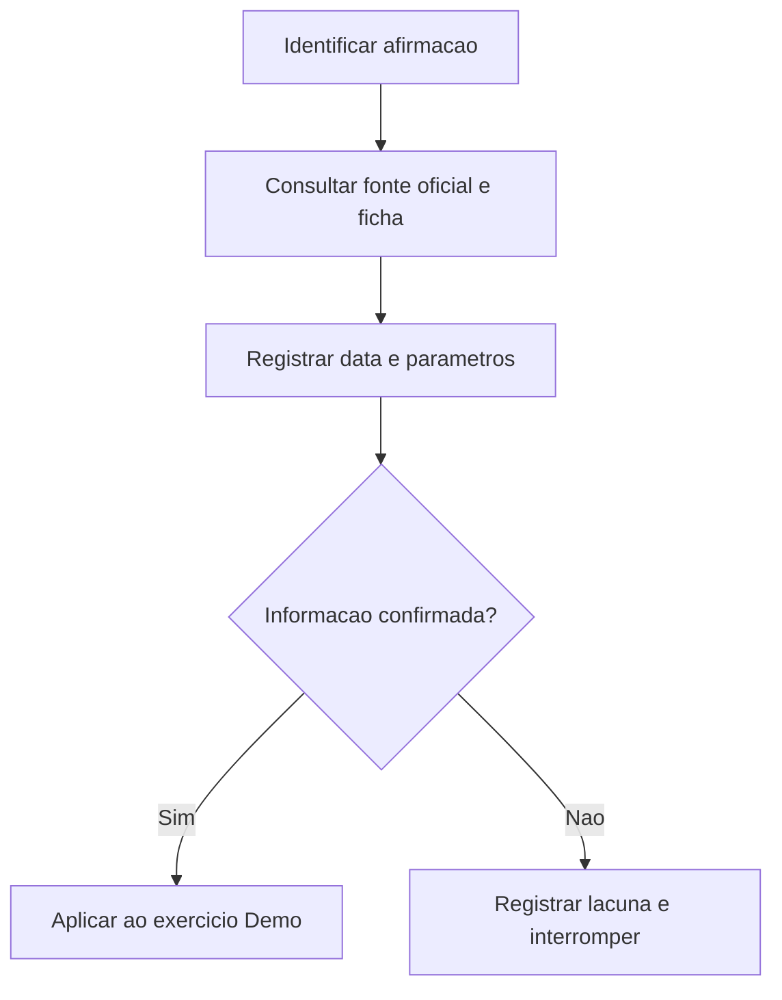

# Fontes e revisão

**Confira comportamento da plataforma em documentação oficial; confira contrato
e parâmetros no servidor da sua Demo.** Os valores financeiros dos módulos são
hipóteses didáticas, não cotações atuais nem especificações universais.

## Caminho de conferência

**Como ler:** identifique o dado, confira a fonte e a ficha do servidor e
registre contexto/data. Informação desconhecida impede a aplicação no
exercício; confirmar uma fonte não substitui os demais gates de risco e proteção.

## Módulo 01: fontes primárias

Consultadas em **2026-11-21**. Menus e recursos podem variar por versão/servidor.

| Documento | O que sustenta |
| --- | --- |
| [Download oficial MT5](https://www.metatrader5.com/en/download) | Origem do terminal Desktop |
| [Observação do Mercado](https://www.metatrader5.com/en/terminal/help/trading/market_watch) | Símbolos, cotações e Especificação |
| [Propriedades do símbolo](https://www.mql5.com/en/docs/constants/environment_state/marketinfoconstants) | Ponto, tick, contrato, moedas e restrições |
| [Abertura de conta](https://www.metatrader5.com/en/terminal/help/startworking/acc_open) | Demo, tipo de conta, moeda e saldo |
| [Gráficos](https://www.metatrader5.com/en/terminal/help/charts_advanced/charts_settings) | Grade, Bid/Ask, contraste e níveis |
| [Configurações](https://www.metatrader5.com/en/terminal/help/startworking/settings) | Preferências de negociação |
| [One-Click Trading](https://www.metatrader5.com/en/terminal/help/trading/one_click_trading) | Envio imediato, riscos do clique e níveis |
| [Execução de ordens](https://www.metatrader5.com/en/terminal/help/trading/performing_deals) | F9, mercado, SL/TP, posições e saldos |
| [Princípios de negociação](https://www.metatrader5.com/en/terminal/help/trading/general_concept) | Ordem, negócio e posição |
| [OrderCalcProfit](https://www.mql5.com/en/docs/trading/ordercalcprofit) | Estimativa de resultado na moeda da conta |
| [OrderCalcMargin](https://www.mql5.com/en/docs/trading/ordercalcmargin) | Estimativa de margem sob regras vigentes |

As referências de programação explicam o cálculo do servidor; o aluno não
precisa programar. Não atribuímos à MetaQuotes recomendação de saldo, 1% de
risco, alavancagem ou contrato dos exemplos: são hipóteses/protocolos do curso.

## Módulo 02: fontes primárias

Para a estratégia simples, confira período, Bid/Ask, spread, sessão, linha e
propriedades do símbolo:

| Documento | O que sustenta |
| --- | --- |
| [Market Watch](https://www.metatrader5.com/en/terminal/help/trading/market_watch) | Cotação, spread, horário e Especificação |
| [Gráficos e períodos](https://www.metatrader5.com/en/terminal/help/charts_analysis/charts) | Períodos e leitura temporal |
| [Linhas horizontais](https://www.metatrader5.com/en/terminal/help/objects/lines) | Marcação manual do nível |
| [Configuração Bid/Ask](https://www.metatrader5.com/en/terminal/help/charts_advanced/charts_settings) | Linhas de preço e visualização |
| [Propriedades do símbolo](https://www.mql5.com/en/docs/constants/environment_state/marketinfoconstants) | Dígitos, ponto, sessões e restrições |

## Protocolo de conferência

1. Identifique símbolo completo, servidor Demo, moeda da conta e data.
2. Registre contrato, ponto, tick, valor de tick, moedas de lucro/margem, modo de
   cálculo, mínimo/passo e limites de proteção na ficha.
3. Confira a documentação específica quando um comportamento ou regra variar.
4. Recalcule exemplos com dados da sua Demo; não aplique a tabela diretamente.
5. Para o Módulo 02, registre também período, nível, confirmação e invalidação.
6. Guarde a ficha e evidências em local privado, sem credenciais no repositório.

Se faltar informação necessária, registre a lacuna e não execute a ordem.
USDJPY tem cotação nativa própria: a apresentação dos resultados e do risco
permanece em USD, com conversão adequada do servidor.

**Próximo passo:** retorne ao [Módulo 01](../modulo-01/index.md), pratique o
[Módulo 02](../modulo-02/index.md) ou consulte o [glossário](glossario.md).
