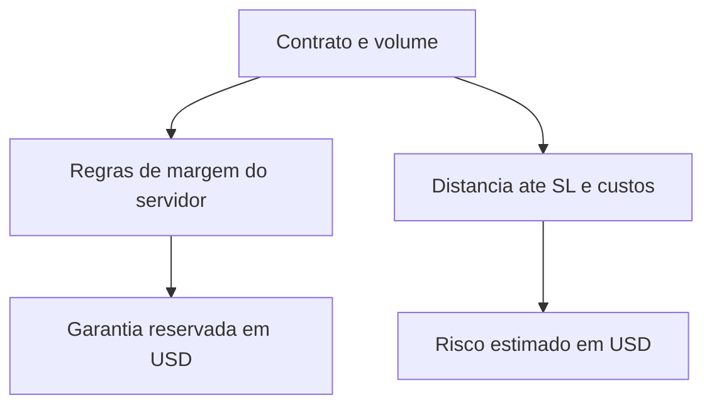

# Glossário essencial

**Use esta página para localizar termos e voltar ao exercício dos Módulos 01 e 02.**
As definições são introdutórias. Características de um instrumento devem ser
conferidas na sua fonte oficial, indicada em [Fontes e revisão](fontes.md).

## Mapa: margem e risco são medidas diferentes

**Como ler:** contrato e volume participam dos dois cálculos. A margem depende
das regras do servidor; o risco estimado considera distância até o stop e
custos, convertidos para USD. Garantia disponível não determina perda máxima.

## Day trade e scalping

Day trade se refere a operações abertas e encerradas no mesmo pregão. Scalping
designa uma abordagem de operações curtas; os critérios exatos de duração e
execução precisam ser definidos no contexto da aula.

## Liquidez e spread

Veja também [unidades e valores financeiros](../modulo-01/1-1-terreno-usd.md).

Liquidez diz respeito às condições de negociar um instrumento sem alterar
substancialmente seu preço. Spread é a diferença entre os melhores preços de
compra e venda disponíveis em um dado momento.

## Estratégia simples: nível e confirmação

No [Módulo 02](../modulo-02/index.md), contexto descreve o que está visível;
nível é uma referência horizontal; confirmação é um fechamento coerente com a
hipótese. Nenhum dos três prevê o próximo preço. A proteção e a decisão de não
executar continuam obrigatórias.

## Slippage

Na [ordem a mercado](../modulo-01/1-4-ordem-mercado.md), registre preço previsto
e executado, sem tratar o stop como garantia de perda máxima.

Diferença entre o preço de execução esperado e o efetivamente obtido. A análise
precisa declarar a referência usada e considerar custos e condições de execução.
Há um campo específico nos [modelos de prática](../pratica/modelos.md).

## Drawdown

Queda em relação a um pico anterior de uma série de capital ou resultado.
Sempre indicar a série, o período e se a medida está em moeda ou percentual.

## Invalidação e não operação

Invalidação é a condição que faz uma hipótese deixar de servir ao exercício.
Não operação é a decisão de esperar ou não executar por falta de condições.
Ambas devem ser descritas no [plano](../pratica/modelos.md#plano-do-exercicio).

## Diário de decisão

Registro da informação disponível, da justificativa e da execução observada,
inclusive quando não há operação. Consulte o
[modelo de diário](../pratica/modelos.md#diario-da-decisao).

## Bloco e aderência

Bloco é um conjunto curto de registros que mantém alvo e regra comparáveis.
Aderência é o quanto as decisões seguiram o plano, incluindo as paradas. O
[Módulo 03](../modulo-03/index.md) revisa primeiro o processo, antes de qualquer
conclusão sobre resultado.

**Próximo passo:** [confira o protocolo de fontes](fontes.md) e retorne à
[estratégia simples](../modulo-02/index.md).

## Pip, ponto e tick

Pip: EURUSD/GBPUSD `0.0001`; USDJPY `0.01`. Ponto MT5 é unidade de cotação;
tick de preço é o menor incremento permitido. Não são necessariamente iguais.
Índices têm também ponto de índice; ouro exige unidade de preço e contrato.

## Lote, nocional, margem e alavancagem

Lote é volume associado ao contrato do servidor. Nocional é exposição; margem
é garantia. Alavancagem pode reduzir margem para o mesmo nocional, sem reduzir
o resultado por movimento do mesmo lote. Confira a Especificação do símbolo.

## Stop Loss e Take Profit

SL/TP são níveis de saída para limitar perda/realizar resultado. Não garantem
preço. No Módulo 01, ambos acompanham o envio da ordem; no Módulo 02, entram na
ficha antes de qualquer prática opcional. Consulte a
[aula 1.4](../modulo-01/1-4-ordem-mercado.md) e a
[aula 2.3](../modulo-02/2-3-confirmacao-risco.md).

## Demo, saldo e capital líquido

Demo usa recursos virtuais. Saldo exclui o resultado flutuante; capital líquido
(equity) incorpora flutuação e ajustes. Margem livre costuma ser equity menos
margem, conforme a conta. O teto didático de 1% usa equity atual em USD;
consulte a [aula 1.3](../modulo-01/1-3-conta-demo.md).
