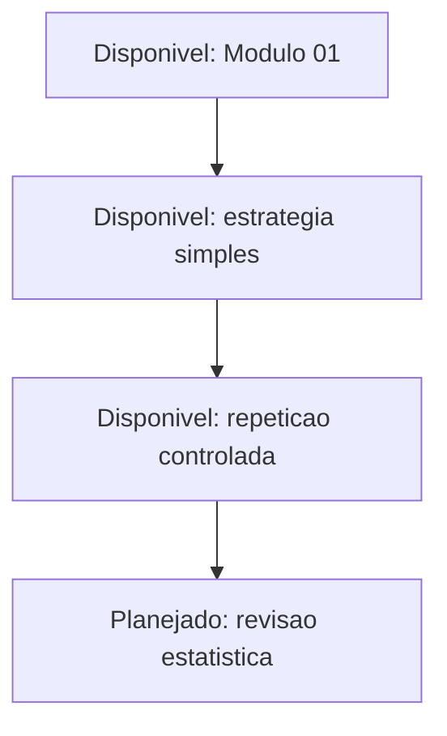

# Trilha de aprendizagem

**Os Módulos 01, 02 e 03 estão disponíveis.** A revisão estatística continua
planejada.
Siga as evidências de aprendizagem; um resultado positivo isolado não comprova
domínio do processo nem autoriza conta real.

## Visão da progressão

**Como ler:** conclua os fundamentos disponíveis antes de estudar as etapas
seguintes, ainda planejadas. As setas indicam pré-requisitos de aprendizagem,
sem representar aprovação para operar em conta real.

## Mercados e moeda

| Mercado | Alvos exclusivos | O que conferir |
| --- | --- | --- |
| Índices globais | US100, US500, US30 | Instrumento/CFD, contrato e valor por ponto |
| Forex | EURUSD, GBPUSD, USDJPY | Pip, tick e conversão de resultado para USD |
| Metais | XAUUSD / ouro | Onças por lote, tick e moeda de lucro |

Conta, risco, custos, margem e resultados sempre em **USD**. Os nomes e sufixos
do MT5 não substituem a Especificação do servidor. Exemplos numéricos têm
hipóteses explícitas; veja [fontes e revisão](referencias/fontes.md).

## Módulo 01 — disponível

| Aula | Pré-requisito | Evidência |
| --- | --- | --- |
| [1.1 — Terreno em dólar](modulo-01/1-1-terreno-usd.md) | Orientação de estudo | Ficha de unidades e cálculo de spread |
| [1.2 — MT5 essencial](modulo-01/1-2-mt5-essencial.md) | 1.1 | Controles localizados, gráfico/lista preparados |
| [1.3 — Demo realista](modulo-01/1-3-conta-demo.md) | 1.2 | Demo/USD, saldo e orçamento de 1% conferidos |
| [1.4 — Mercado e proteção](modulo-01/1-4-ordem-mercado.md) | 1.1–1.3 | Diário de execução protegida ou não execução justificada |

Aula 1.2 pode começar sem conexão; após abrir a Demo na 1.3, finalize a lista
de símbolos e o gráfico. Não há envio de ordem antes dos gates da 1.4.

## Módulo 02 — disponível

| Aula | Pré-requisito | Evidência |
| --- | --- | --- |
| [2.1 — Estratégia simples](modulo-02/2-1-estrategia-simples.md) | Módulo 01 | Cartão de nível, confirmação e proteção |
| [2.2 — Contexto e nível](modulo-02/2-2-contexto-nivel.md) | 2.1 | Ficha do servidor e nível anotado |
| [2.3 — Confirmação e risco](modulo-02/2-3-confirmacao-risco.md) | 2.2 | Invalidação e risco conferidos |
| [2.4 — Prática guiada](modulo-02/2-4-pratica-guiada.md) | 2.1–2.3 | [Diário de bordo](pratica/diario-bordo.md) preenchido |

## Módulo 03 — disponível

| Aula | Pré-requisito | Evidência |
| --- | --- | --- |
| [3.1 — Preparar bloco](modulo-03/3-1-preparar-bloco.md) | Módulo 02 | Cartão do bloco |
| [3.2 — Registrar tentativa](modulo-03/3-2-registrar-tentativa.md) | 3.1 | Linhas completas no Diário |
| [3.3 — Revisar aderência](modulo-03/3-3-revisar-aderencia.md) | Registros | Resumo do bloco |
| [3.4 — Fechar bloco](modulo-03/3-4-fechar-bloco.md) | 3.3 | Próxima ação única |

## Etapas futuras — planejadas

| Etapa | Pré-requisito | Evidência prevista | Estado |
| --- | --- | --- | --- |
| Revisão estatística | Bloco comparável fechado | Separação entre hipótese, execução e resultado | Planejado |

Cada etapa terá Spec própria antes da implementação. Concluir o módulo inicial
não implica evidência de vantagem operacional.

**Próximo passo:** [objetivos e regras do Módulo 01](modulo-01/index.md).
